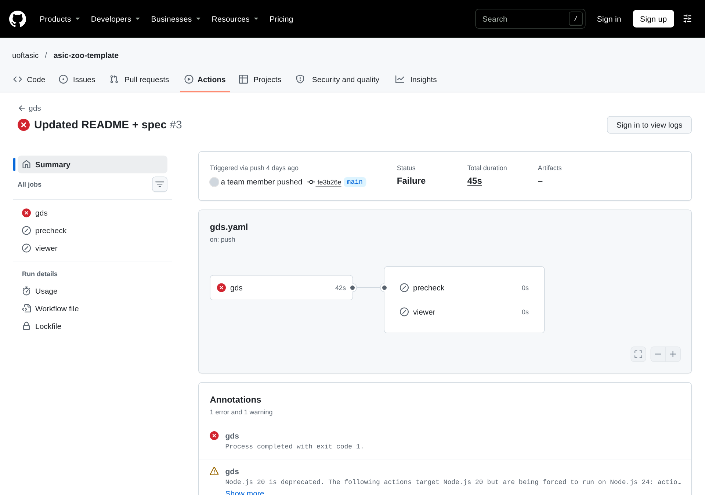
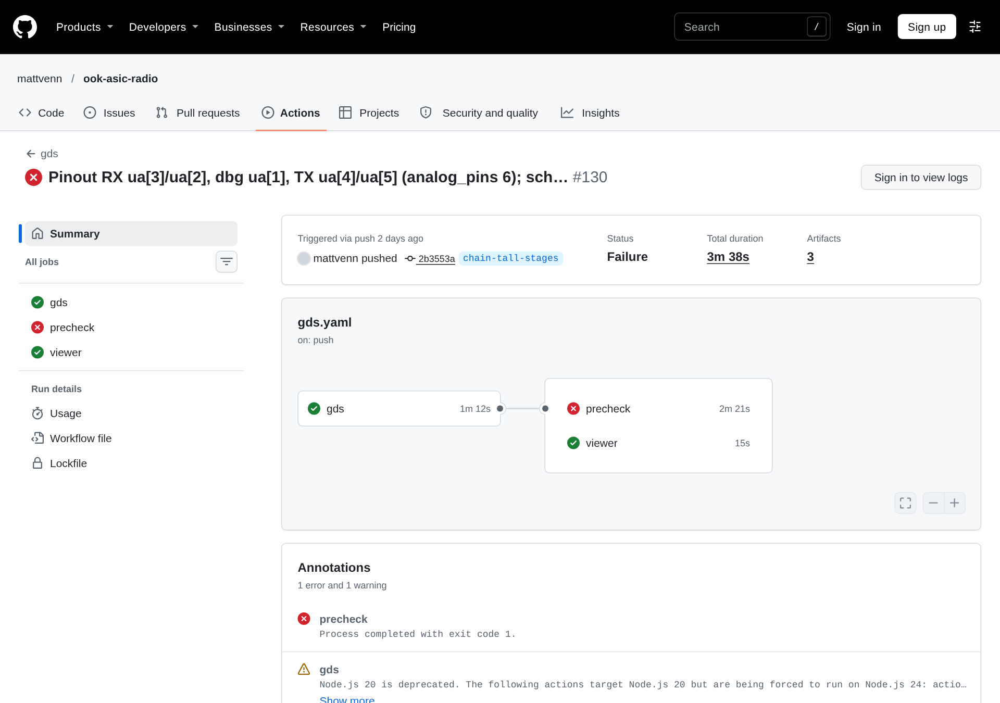

# The analog workflows

This page answers: *what does each job in the analog template's two workflows do, and what does a
red cross on each one usually mean?*

[Reading a workflow file](reading-a-workflow-file.md) explains how to read any workflow. This page
goes through the two the analog template gives you, `docs.yaml` and `gds.yaml`, as they are at the
template's commit `301590b` (Sep 15, 2026), with every action at the tag `ttsky26d`. The steps
quoted are from Tiny Tapeout's actions at that tag. You'll see each of the failures described here
in [Lab 01](../labs/lab-01-your-repo-from-the-template-overview.md) and
[Lab 02](../labs/lab-02-read-the-red-x-overview.md).

The biggest difference from the digital template is that nothing on the runner builds your layout.
A digital project's `gds` job runs LibreLane for several minutes to turn Verilog into a layout. In
an analog project you draw the layout yourself, on your own machine, and commit the result, and
the runner only copies it, checks it and publishes it. The analog template also has no `test`
workflow and no `gl_test` job, because there's no Verilog to simulate: `src/project.v` is an empty
module that only declares the pins.

## docs

`docs.yaml` has one job, `docs`, with two steps: it checks out your repository, then runs Tiny
Tapeout's docs action. Inside that action, the step that matters is "Check info.yaml and
docs/info.md", which runs `tt_tool.py --check-docs` from Tiny Tapeout's support tools. That reads
`info.yaml` with the same validator the rest of Tiny Tapeout uses, and `docs/info.md` for the
template's placeholder sentences, and prints every problem it finds before it fails:

```
## Errors in info.yaml
- Please fill in the 'pinout' section

## Errors in docs/info.md
- Missing 'How it works' section in docs/info.md
- Missing 'How to test' section in docs/info.md
```

That's from the team's `crosswalk` on Nov 8, 2026. If the check passes, the action goes on to build
your page of the datasheet as a PDF, with Pandoc and Typst, and uploads it as an artifact called
`PDF`.

The `docs` job runs in parallel with `gds` and finishes first, in about half a minute, so it's
usually the first red cross you see. It doesn't look at your layout at all. The course's
`make docs` runs the same check function, from the same commit of the support tools, on your own
machine.

## gds

`gds.yaml` has three jobs. The first, `gds`, packages your layout; the other two, `precheck` and
`viewer`, each start with `needs: gds`, so they run only if it passes, and then they run side by
side.

{width=760}

### The gds job

Two steps of the job are in your repository's `gds.yaml`. "Read top module name" reads
`top_module` from `info.yaml` with `yq`, and "Create and publish the GDS artifact" passes it to
Tiny Tapeout's `custom_gds` action, along with three paths built from it:
`gds/<top_module>.gds`, `lef/<top_module>.lef` and `src/project.v`. Inside `custom_gds`:

1. It writes two small files, `commit_id.json` (which repository, commit and run this is) and
   `pdk.json` (`sky130A`), into a folder called `tt_submission`.
2. It installs KLayout 0.29.12.
3. "Copy GDS / LEF files to tt_submission" copies your GDS and LEF into `tt_submission`, under
   your top module's name, writes an OASIS copy of the GDS with KLayout's `strm2oas`, and copies
   `src/project.v` in as `<top_module>.v`.
4. It uploads `tt_submission`, together with `info.yaml`, `LICENSE` and `docs/`, as the
   `tt_submission` artifact. The other two jobs start from that artifact, not from your
   repository.
5. It renders a PNG picture of the layout and uploads it as the `gds_render` artifact. If the
   render fails, the step prints a warning and the job carries on.

Step 3 is where a new analog repository first fails, with the GDS file missing:

```
cp: cannot stat 'gds/tt_um_example.gds': No such file or directory
##[error]Process completed with exit code 1.
```

That's from the team's `asic-zoo-template`, which had no layout yet. The same line comes from a
`top_module` in `info.yaml` that doesn't match the file's name, because the path is built from
`top_module`. This job never opens your GDS, so a layout that's wrong in every way passes it as
long as the two files exist.

### The precheck job

`precheck` downloads the `tt_submission` artifact and checks it. Its own steps install what it
needs, and that's most of its run time:

1. It checks out Tiny Tapeout's support tools from their `main` branch, which holds `precheck.py`.
2. It installs the `sky130A` PDK at commit `0536d02d…`, fixed in the action, with Tiny Tapeout's
   `ciel` action.
3. It builds Magic and KLayout through Nix, at versions fixed by two Nix package commits: Magic
   8.3.568 and KLayout 0.30.8.
4. "Run precheck" runs `precheck.py` on your GDS: 15 checks for `sky130A`, all of them, even
   after one fails. [What precheck checks](what-precheck-checks.md) goes through them.
5. Three more steps run whether or not the checks passed (`if: always()`). "Test Summary" and
   "Capture test results" put precheck's table of results on the run's summary page, and "Upload
   reports" uploads the reports folder as the `precheck_reports` artifact.

When `precheck` is red, start with the table on the run's summary page; it names every failed check
with its message. Then read the log of "Run precheck" for the details. Once in a while the job fails
before it checks anything, in a step that downloads something. On Nov 9, 2026 a public project's
`precheck` failed in "Install sky130A PDK" with `The read operation timed out`, which says nothing
about the layout; re-running the failed job is the right response to that.

In the team's repositories, `precheck` took between 91 and 315 seconds. In one public analog
project's run on Nov 14, 2026 it took 2 min 21 s, after a `gds` job of 1 min 12 s.

### The viewer job

`viewer` downloads `tt_submission` and `gds_render`, writes a one-page website that sends its
visitor to Tiny Tapeout's 3D viewer with your layout loaded, and deploys that page with GitHub
Pages. It needs Pages turned on with GitHub Actions as the source, and a new repository has Pages
off, so `viewer` fails on the first run that gets that far:

```
##[error]Error: Failed to create deployment (status: 404) with build version ... Ensure GitHub Pages has been enabled: https://github.com/uoftasic/protocol-emulator/settings/pages
```

The fix is to turn Pages on (Settings › Pages › Build and deployment › Source: **GitHub Actions**)
and then start a new run, with **Run workflow** or a new push, rather than re-running the failed
one: at the `ttsky26d` tag, a re-run of `viewer` within a day of the first attempt fails with
`Multiple artifacts named "github-pages"`.
[Reading a workflow file](reading-a-workflow-file.md#github-pages-and-the-viewer) has the rest of
that log and the story of that trap. When it works, the job's summary has links to the 3D viewer
and to Tiny Tapeout's GDS explorer, and your Pages site redirects to the viewer.

`viewer` doesn't depend on `precheck`, so it passes even when precheck fails, and a run can end
with `precheck` red and `viewer` green:

{width=760}

In this course a workflow counts as passing only when all three jobs are green.

## Which push runs what

The template's two workflows start on every push, to any branch, and on `workflow_dispatch`, the
**Run workflow** button. There is no `pull_request` trigger. A pull request between two branches of
your own repository still shows checks, because each push to its branch started runs on the
branch's latest commit, and GitHub shows those.

Every push runs `viewer` too, whichever branch it's on, so your Pages site shows the layout from
the last run whose `viewer` job deployed, not necessarily `main`'s. The team's `sentry` deploys
from feature branches routinely; its `gds` run of Nov 16, 2026 on the branch
`12-implement-rtl-for-window-controller-module`
([run 43796948508](https://github.com/uoftasic/sentry/actions/runs/43796948508)) passed with
`viewer` green.

## Pull requests in a shared repository

In Lab 04 your partner's change reaches your review repository as a pull request from a fork, and
that needs two changes to the template's `gds.yaml` and `docs.yaml`, which the course's sandbox
makes:

- **A `pull_request` trigger.** GitHub's documentation says "Workflows don't run in forked
  repositories by default", so a push to your fork starts nothing. A pull request from the fork
  into the repository it came from does start that repository's `pull_request` workflows, which
  check the commit GitHub would make if the pull request were merged ("`GITHUB_SHA` for this event
  is the last merge commit of the pull request merge branch"). The sandbox also limits its `push`
  trigger to `main`.
- **`viewer` skipped on pull requests**, with `if: github.event_name != 'pull_request'`. In a pull
  request from a fork, "The `GITHUB_TOKEN` has read-only permissions", so a deploy would fail, and
  a pull request shouldn't replace `main`'s page anyway. A skipped job doesn't fail the run.

GitHub's documentation adds one more rule that you'll meet in Lab 04: "Workflows will not run on
`pull_request` activity if the pull request has a merge conflict." Once someone else's change to
the same lines is merged, your pull request's checks stop until you resolve the conflict.

## Check yourself

1. A `gds` run shows the `gds` job red after 40 seconds, and `precheck` and `viewer` grey. Which
   step do you open first, and what are the two likely causes?

   <details>
   <summary>Answer</summary>

   "Copy GDS / LEF files to tt_submission", inside "Create and publish the GDS artifact". It's
   the only step in the job that reads your files, and a short failure there means one of them
   isn't where the workflow looks: no layout committed yet, or a `top_module` in `info.yaml` that
   doesn't match the files' names. The other two jobs are grey because they `need` this one.

   </details>

2. Your `precheck` is red with a ❌ on "Magic DRC", and your `viewer` is green. Does the 3D viewer
   show your layout?

   <details>
   <summary>Answer</summary>

   Yes. `viewer` needs only `gds`, so it published the layout that `gds` packaged, DRC errors and
   all. A green `viewer` says nothing about whether the layout is right.

   </details>

3. Why can't you run the template's `gds` workflow on a pull request from a fork without changing
   it?

   <details>
   <summary>Answer</summary>

   It has no `pull_request` trigger, and the fork's own workflows don't run by default, so nothing
   would run at all.

   </details>
