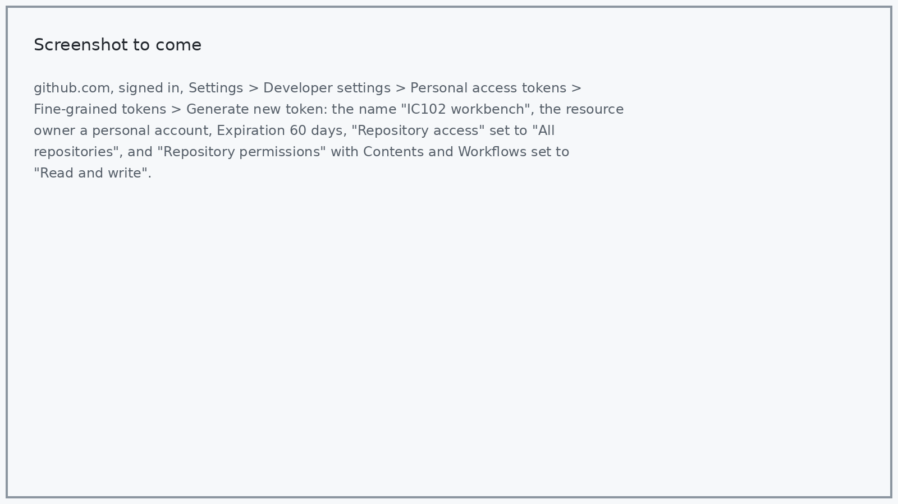
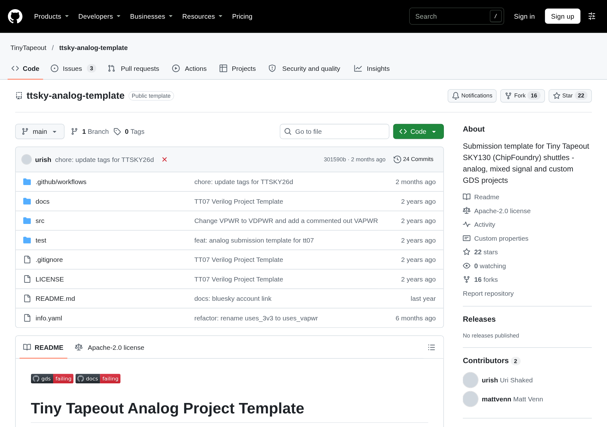
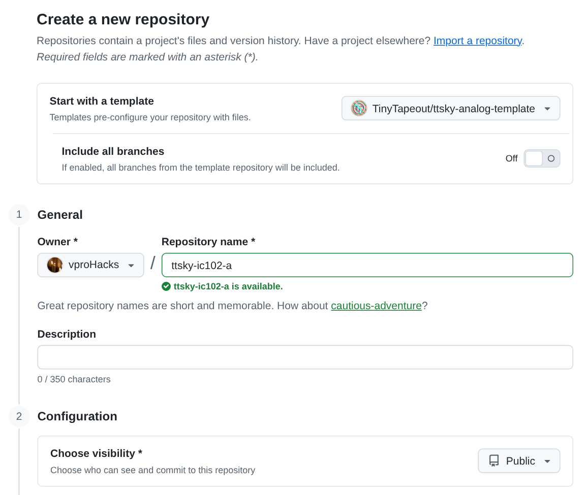
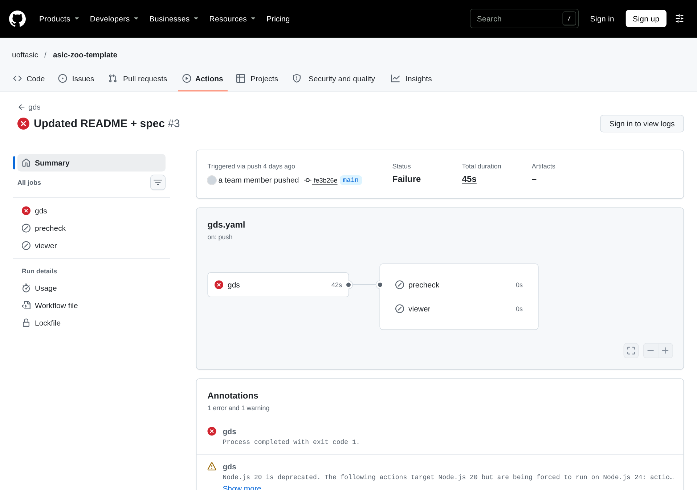
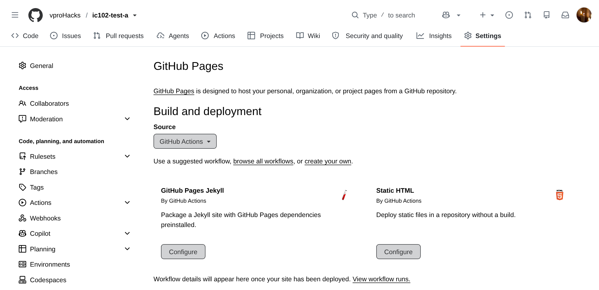
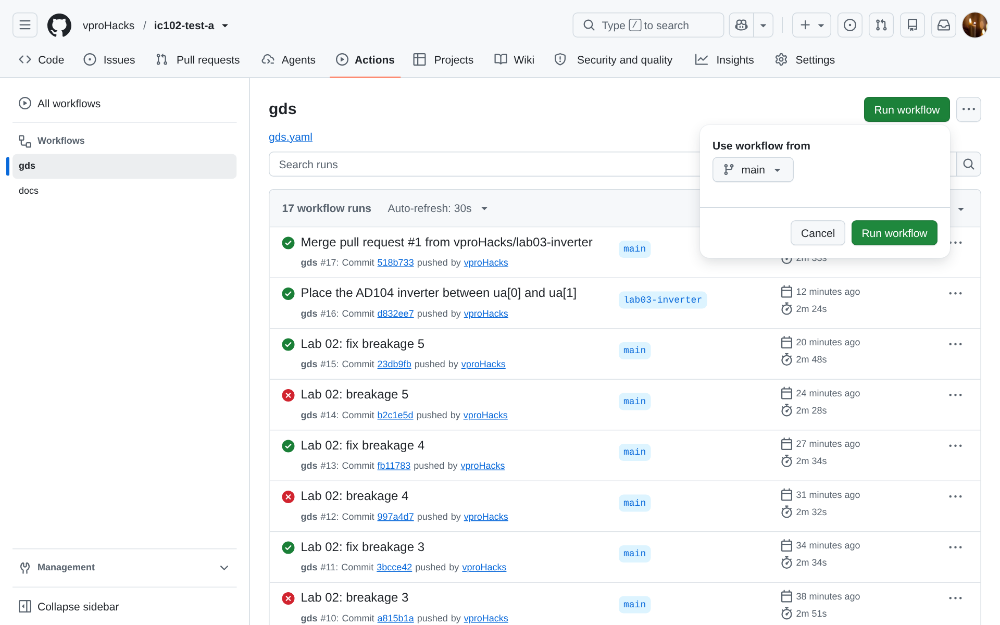
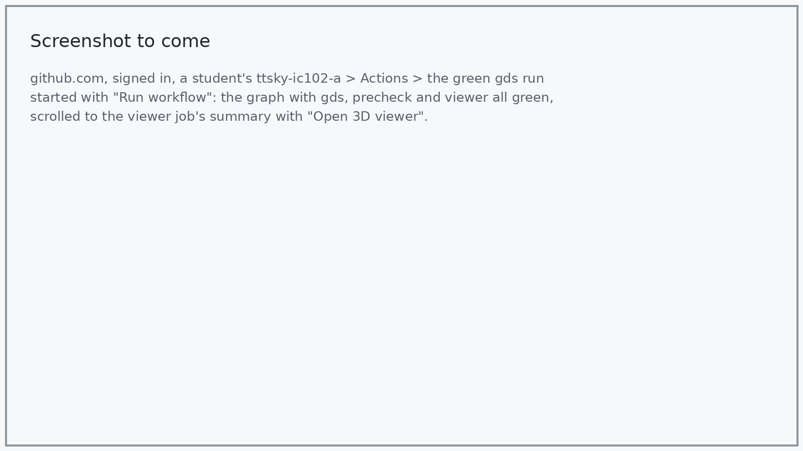

# Lab 01: Your repository from the template

You'll make your own public repository from Tiny Tapeout's analog template and fill in the two
files its checks read. Then you'll commit a placeholder layout, the template's empty 1x2 frame as
Tiny Tapeout's own script draws it, and keep going until both of the template's workflows pass on a
commit you made, the `viewer` job included. You'll come back to this repository in later labs.

Package: [`labs/lab-01-your-repo-from-the-template/`](https://github.com/uoftasic/ic102-a/tree/main/labs/lab-01-your-repo-from-the-template)

## Before you start

- Read [Getting started](../guide/getting-started.md), [Git in one page](../guide/git-in-one-page.md)
  and [Templates, forks and clones](../guide/templates-forks-and-clones.md).
- You need [IC101](https://uoftasic.com/ic101/) done (the workbench desktop opens and you can get a
  terminal), a GitHub account, and about 2 GB of free disk for the course tools.

This lab takes about 1 h 15 min. Half of that is waiting for GitHub's runners, which is a good time
to read ahead.

In the outputs below, the top module is `tt_um_yourname_ic102`, and yours will have your own
username in it. The repository is `ttsky-ic102-a`, the name the rest of the course uses for it.

## Part 1: Load the course

If you haven't set up the workbench yet, do
[IC101 Lab 03](https://uoftasic.com/ic101/labs/lab-03-launch-the-workbench-overview.html) first.

1. From your `workspace` clone, start the desktop (`./scripts/start_vnc.sh`, or
   `scripts\start_vnc.bat` on Windows), open <http://localhost/> and open a terminal on the
   desktop. Every command in this course runs in that terminal.

2. Load the environment and get the course files:

   ```bash
   . /foss/designs/common/.designinit   # in every new terminal
   mod add ic102-a                      # first time only: clones github.com/uoftasic/ic102-a
   mod ic102-a
   ```

   You should see the `ASIC-EDU: PDK=sky130A ...` banner and, as the last line,
   `cwd: /foss/designs/modules/ic102-a`.

   <!-- RUN-TODO: the output of `mod add ic102-a` once github.com/uoftasic/ic102-a is published. -->

3. Install the course's copy of precheck's tools. They're installed alongside the workbench's own
   tools, in `labs/common/tt-tools/.local`. That folder is on your own disk, so you only do this
   once:

   ```bash
   cd labs/common/tt-tools
   make install
   make check-tools
   ```

   `make install` took 85 s on one CPU core with a fast connection, and the tools take up 1.8 GB.
   [Your tools and the runner's tools](../guide/your-tools-and-the-runners-tools.md) explains why
   the course installs these at all. `make check-tools` should end with this table:

   ```
   Tool               Runner (pinned)      Here                 Workbench            Status
   ----               ---------------      ----                 ---------            ------
   Python             3.11.18              3.11.16              3.12.3               ok (3.11)
   Magic              8.3.568              8.3.568              8.3.681              ok
   KLayout            0.30.8               0.30.8               0.30.11              ok
   klayout (pip)      0.30.13              0.30.13              0.30.11              ok
   gdstk (pip)        0.9.52               0.9.52               1.0.1                ok
   yowasp-yosys       0.63.0.0.post1107    0.63.0.0.post1107    -                    ok
   ciel               3.2.0                3.2.0                2.6.1                ok
   sky130A PDK        0536d02d875c         0536d02d875c         026824c7969c         ok
   tt-support-tools   9d13ff3e3e62         9d13ff3e3e62         -                    ok

   All pinned tools are installed at the runner's versions.
   ```

| If you see | Do this |
|---|---|
| `mod: no such module: ic102-a` | You ran `mod ic102-a` before `mod add ic102-a`. |
| `The read operation timed out` during `make install` | The PDK's download server didn't answer in time. Run `make install` again; it starts from the part that failed. |
| Anything marked `MISSING` in `make check-tools` | Run `make install` again and read the last lines it prints. |

For anything else, see IC101's [Troubleshooting](https://uoftasic.com/ic101/reference/troubleshooting.html)
page. [The tools' README](https://github.com/uoftasic/ic102-a/tree/main/labs/common/tt-tools) has more rows.

Check: `make check-tools` ends with `All pinned tools are installed at the runner's versions.`

## Part 2: Your GitHub settings

This part sets up two things the rest of the course needs: an email address for your commits, and
a way for the workbench to push to GitHub.

1. On GitHub, open Settings › Emails, turn on the "Keep my email addresses private" switch, and
   copy the no-reply address that GitHub then shows, which has the form
   `ID+USERNAME@users.noreply.github.com`.
   [Git in one page](../guide/git-in-one-page.md#commit-identity) says why.

2. Make a token for the workbench to push with: Settings › Developer settings › Personal access
   tokens › **Fine-grained tokens** › **Generate new token**. Give it:

   - Token name `IC102 workbench`, Resource owner your own account, and Expiration 60 days;
   - Repository access: **All repositories**;
   - Repository permissions: **Contents** and **Workflows**, both "Read and write". GitHub adds
     Metadata, read-only, by itself. Leave everything else as it is.

   Copy the token into your password manager now, because GitHub shows it only once.

   <!-- SCREENSHOT-TODO: github.com, signed in, Settings > Developer settings > Personal access tokens > Fine-grained tokens > Generate new token: the name "IC102 workbench", the resource owner a personal account, Expiration 60 days, "Repository access" set to "All repositories", and "Repository permissions" with Contents and Workflows set to "Read and write". One account is enough; the same capture serves IC102-D. Not taken in the live test of Nov 16, 2026: that test was allowed to open only its two test repositories, the template page and Settings > Emails, and the token form is a security page. -->
   {width=640}

   [Getting started](../guide/getting-started.md#pushing-from-the-workbench) explains why it's
   this kind of token, why it needs Workflows as well as Contents, and why it lives in your password
   manager rather than in a file.

   <!-- RUN-TODO: with this token, from the workbench: a push to the student's own ttsky-ic102-a, the first push of the Lab 04 sandbox copy (it adds workflow files) to a new empty ttsky-ic102-a-review, a branch pushed to the student's ttsky-ic102-a-review-fork, and GitHub's exact refusal when Workflows is left off, to quote in Getting started. Needs two accounts for the fork (a second account's ttsky-ic102-a-review to fork); the rest needs one. The live test of Nov 16, 2026 couldn't do this: it wasn't allowed to make a token (an account setting), so its pushes used the GitHub CLI's own sign-in, which proves nothing about this token. -->

Check: you have the no-reply address and the token saved somewhere you can paste from.

## Part 3: Make the repository

What does a repository made from the template contain, and which of its workflows pass before
you've changed anything?

1. Open <https://github.com/TinyTapeout/ttsky-analog-template>, click **Use this template** ›
   **Create a new repository**, choose your own account as the owner, name it `ttsky-ic102-a`, make
   it **Public**, and click **Create repository**. It has to be public, because GitHub Pages, which
   the `viewer` job needs, works only on public repositories on a free account.

   {width=760}

   {width=640}

2. Before you look at the Actions tab, write down how many workflow runs you expect to find there
   already, and whether each will pass. The template's `.github/workflows/` has two files.

3. Open your repository's **Actions** tab. You should see two runs, `docs` and `gds`, both on the
   commit "Initial commit", and both red, as they were on the team's `asic-zoo-template` on Nov 11,
   2026.

   <details>
   <summary>Answer</summary>

   Both workflows run on every push (`on: push`), and creating the repository pushed its first
   commit. `docs` fails because `info.yaml` and `docs/info.md` still hold the template's empty
   values and placeholder text. `gds` fails because the template has no layout in it: the `gds`
   job looks for `gds/tt_um_example.gds` and the file doesn't exist. You'll see both messages in
   Parts 4 and 5.

   </details>

4. Clone it into the workbench, into a `projects` folder of your workspace:

   ```bash
   mkdir -p /foss/designs/projects && cd /foss/designs/projects
   git clone https://github.com/YOUR-USERNAME/ttsky-ic102-a.git
   cd ttsky-ic102-a
   git log --oneline
   ```

   You should see `Cloning into 'ttsky-ic102-a'...` and a log of exactly one commit, "Initial
   commit", whose hash is your own. The template's own history has been left behind, as
   [Templates, forks and clones](../guide/templates-forks-and-clones.md) says it would.

5. Tell git who you are, and to remember your token, in this repository:

   ```bash
   git config user.name "Your Name"
   git config user.email "ID+USERNAME@users.noreply.github.com"
   git config credential.helper 'cache --timeout=28800'
   ```

   The third line keeps your token in memory for 8 hours after you first type it, so you're asked
   for it about once a session. Leave out `--global`. A global setting goes into the container's
   home folder, which is thrown away whenever the workbench restarts, and your next commit would
   then stop with this:

   ```
   Author identity unknown

   *** Please tell me who you are.
   ...
   fatal: unable to auto-detect email address (got 'designer@41bf5069a52d.(none)')
   ```

   A setting without `--global` goes into `.git/config` in the repository, which is on your own
   disk, so it's still there after a restart. You'll repeat these three lines in each repository you clone or create in this
   course.

6. See which version of Tiny Tapeout's actions your workflows run:

   ```bash
   grep -n "uses:" .github/workflows/*.yaml
   ```

   You should see four lines that end in `@ttsky26d`, the docs action in `docs.yaml` and
   `custom_gds`, `precheck` and `viewer` in `gds.yaml`, plus two `actions/checkout@v4`. That tag is
   now fixed in your repository's workflow files.
   [The analog workflows](../guide/the-analog-workflows.md) goes through what each of the three
   `gds.yaml` jobs does.

Check: `git log --oneline` shows one commit, and `git config user.email` prints your no-reply
address.

## Part 4: Fill in info.yaml and docs/info.md

Which of the `docs` workflow's complaints can you fix before you push?

1. Add the course's layout kit to your repository. The kit includes a `Makefile` whose `make docs`
   runs the same check as the `docs` job:

   ```bash
   /foss/designs/modules/ic102-a/labs/lab-01-your-repo-from-the-template/start.sh .
   make docs
   ```

   `start.sh` lists what it added (`Makefile`, `layout/`, and a line in `.gitignore`). You should
   then see:

   ```
   ## Errors in info.yaml
   - Project title cannot be empty
   - Project author cannot be empty
   - Project description cannot be empty
   - Please fill in the 'pinout' section

   ## Errors in docs/info.md
   - Missing 'How it works' section in docs/info.md
   - Missing 'How to test' section in docs/info.md

   make: *** [Makefile:100: docs] Error 1
   ```

   That's the list that the `docs` run on the team's `hart-1` printed on GitHub, word for word,
   because `make docs` runs the same function from the same commit of Tiny Tapeout's support tools.

2. Edit `info.yaml`. Fill in `title`, `author` and `description`; the author is public, so write
   whatever you're happy to see in a datasheet. Set `top_module` to `tt_um_` followed by your GitHub
   username and `_ic102`, in lower case with any `-` changed to `_`, because the name becomes a
   Verilog module name. Give `ua[0]` and `ua[1]` a description each, such as
   `"inverter input (not connected yet)"` and `"inverter output (not connected yet)"`. Leave
   `analog_pins: 2` and `tiles: "1x2"` as they are.

3. Replace the two placeholder sentences in `docs/info.md`, "Explain how your project works" and
   "Explain how to use your project", with a sentence or two of your own.

4. In `src/project.v`, change `module tt_um_example` to your top module's name.

5. Run `make docs` again. You should see `Documentation check passed successfully.`

6. Commit and push:

   ```bash
   git add -A
   git commit -m "Fill in info.yaml and docs/info.md, and add the IC102-A layout kit"
   git push
   ```

   git asks for a username and a password: give your GitHub username, and paste the token as the
   password. The cache you set up in Part 3 keeps it for 8 hours, and forgets it when the workbench
   restarts.

7. Before the runs finish, predict which of the two workflows will be green this time. Then open
   the `gds` run, then its `gds` job, then the failed step, and write down its first error line.

   You should see `docs` green and `gds` red, with the same message that every push to the team's
   `asic-zoo-template` produced before it had a layout. That repository still had the template's
   top module, so its message read as below; yours has your own top module in place of
   `tt_um_example`:

   ```
   cp: cannot stat 'gds/tt_um_example.gds': No such file or directory
   ```

   {width=760}

   <details>
   <summary>Why are precheck and viewer grey?</summary>

   Both are declared with `needs: gds`, so they run only if the `gds` job succeeds. It failed at
   its copy step, so they were skipped.

   </details>

Check: the `docs` run on your commit is green.

## Part 5: A placeholder layout

What's the least layout that passes precheck?

1. Run `make`. You should see:

   ```
   layout/init.tcl draws a cell called 'tt_um_analog_example', but top_module in info.yaml is 'tt_um_yourname_ic102'.
   Set TOP_LEVEL_CELL in the settings block of layout/init.tcl to tt_um_yourname_ic102.
   make: *** [Makefile:71: check-top] Error 1
   ```

   `layout/init.tcl` is Tiny Tapeout's own `magic_init_project.tcl`, copied unchanged, and its
   comments ask you to change the settings block at the top. Change `TOP_LEVEL_CELL` to your top
   module. A GDS whose top cell has a different name from `top_module` fails precheck, as you'll
   see in Lab 02.

2. Run `make` again. You should see:

   ```
   magic: the kit's frame and power stripes (layout/init.tcl)
   magic: your additions (layout/wires.tcl), then GDS and LEF
   wrote gds/tt_um_yourname_ic102.gds and lef/tt_um_yourname_ic102.lef
   ```

   The frame has every pin of the 1x2 tile, a VDPWR and a VGND stripe on metal 4, and nothing else.
   `layout/wires.tcl` adds a 9 µm stub of metal 4 to `ua[0]` and to `ua[1]`. Read its comment:
   why does an empty frame need those two stubs?

   <details>
   <summary>Answer</summary>

   `info.yaml` says `analog_pins: 2`, and precheck's analog pin check fails unless each of the
   first two analog pins touches some metal (and has a description in the pinout, which you gave
   it in Part 4). An empty frame has nothing on `ua[0]` or `ua[1]`. The stubs aren't connected to
   anything; in Lab 03 you replace them with wires to an inverter.

   </details>

3. Run precheck on it before you push, with the same tool versions the runner uses:

   ```bash
   make precheck
   ```

   It takes about 45 s. You should see `INFO: Precheck passed for .../tt_um_yourname_ic102.gds! 🎉`
   and a table of 15 checks, every one ✅, from `Magic DRC` to `Verilog syntax check`.

4. Commit `layout/`, `gds/` and `lef/`, and push:

   ```bash
   git add -A
   git commit -m "Add the 1x2 frame with stubs on ua[0] and ua[1]"
   git push
   ```

   `git status` afterwards shouldn't list `tt_submission/` or `layout/build/`: the template's
   `.gitignore` and the kit's line in it keep precheck's and Magic's scratch files out of git.

5. Predict which jobs of the new `gds` run will pass, then open it. You should see `gds` and
   `precheck` green and `viewer` red. The `viewer` job's log will have a line like this one, from
   `vproHacks/ic102-test-a`, a repository we made from the template to test this lab. Its `gds` run
   on Nov 16, 2026 took 3 min 52 s:

   ```
   ##[error]Error: Failed to create deployment (status: 404) with build version e9a6f474deb92b2898e062ddb8f54bcf052b1d73. Request ID 5868:1C0C8:4B853B6:F3D6856:6AFAB74A Ensure GitHub Pages has been enabled: https://github.com/vproHacks/ic102-test-a/settings/pages
   ```

   Yours has its own build version and request ID, and your repository's address at the end.

Check: `precheck` is green on GitHub, and its table on the run's summary page matches the one
`make precheck` printed.

## Part 6: Turn on Pages

How do you get the `viewer` job green without changing a file?

1. In your repository, open Settings › Pages, and under Build and deployment set Source to
   **GitHub Actions**.

   {width=640}

2. Don't press "Re-run failed jobs" on the red run. The `viewer` action at `ttsky26d` uploads an
   artifact called `github-pages` on every attempt, and a re-run keeps the first attempt's, so the
   re-run fails with `Multiple artifacts named "github-pages"`.
   [Reading a workflow file](../guide/reading-a-workflow-file.md#re-running-a-run) explains why.
   Start a new run instead: Actions › gds › **Run workflow** › branch `main` › **Run
   workflow**. (A new push would start one too, but you have nothing to push.)

   {width=640}

3. You should see all three jobs green. The `viewer` job's summary, on the run's summary page, has
   an "Open 3D viewer" link, and `https://YOUR-USERNAME.github.io/ttsky-ic102-a/` now redirects to
   Tiny Tapeout's viewer, with your frame and its two stubs in it.

   {width=760}

Check: the run is green from end to end.

## Finishing

You're done when the latest commit on your repository's `main`, a commit you made, has a green
`docs` run and a green `gds` run with all three jobs (`gds`, `precheck` and `viewer`) passed.

Questions:

1. Your third run was started by hand, not by a push. Which commit did it check?

   <details>
   <summary>Answer</summary>

   The latest commit on the branch you chose, `main`, which was your Part 5 commit. "Run workflow"
   runs the workflow file and the files as they are on that branch's latest commit.

   </details>

2. The `gds` job in Part 4 failed in well under a minute. A digital project's `gds` job took between
   207 s and 1,056 s in the team's repositories. Why is the analog one so much faster even when it
   passes?

   <details>
   <summary>Answer</summary>

   Because it doesn't build anything. A digital project's `gds` job runs LibreLane to turn Verilog
   into a layout, whereas the analog template's `custom_gds` step only copies the GDS and LEF you
   committed, converts the GDS to OASIS and renders a picture of it. All the layout work happened
   on your machine, when you ran `make`.

   </details>

Submit: nothing for this lab. Keep the repository; Labs 02, 03 and 05 use it.

Next on the [Course path](../index.md#course-path): read [What a cloud runner is](../guide/what-a-cloud-runner-is.md),
[Reading a workflow file](../guide/reading-a-workflow-file.md) and
[The analog workflows](../guide/the-analog-workflows.md), then do
[Lab 02: Read the red X](lab-02-read-the-red-x-overview.md).
