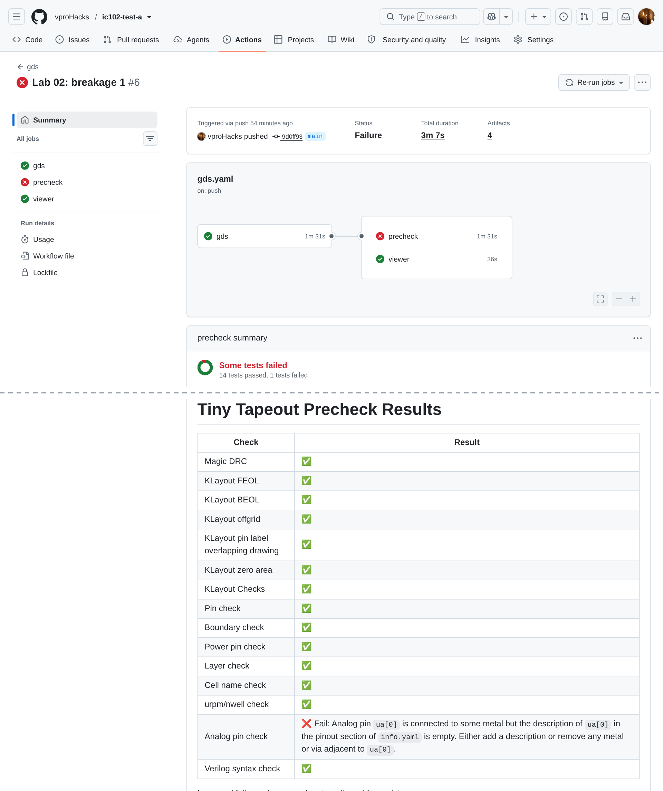

# Lab 02: Read the red X

You'll put five mistakes into your repository from Lab 01, one at a time. Each is one that a real
analog project has made, or one that a precheck rule exists to catch. For each one, you predict
which job will fail and push the commit. Then you find the failed job, the step inside it and the
first error line on GitHub, and write them down in `DIAGNOSIS.md` before you fix the mistake.

Package: [`labs/lab-02-read-the-red-x/`](https://github.com/uoftasic/ic102-a/tree/main/labs/lab-02-read-the-red-x)

## Before you start

- Read [What a cloud runner is](../guide/what-a-cloud-runner-is.md),
  [Reading a workflow file](../guide/reading-a-workflow-file.md) and
  [The analog workflows](../guide/the-analog-workflows.md).
- Finish [Lab 01](lab-01-your-repo-from-the-template-overview.md): every workflow green on your
  latest commit.

This lab takes about 1 h 10 min, about a quarter of an hour for each breakage, most of it spent
waiting for runs. When we ran this lab on a test repository on Nov 16, 2026, each `gds` run took
between 2 min 28 s and 3 min 11 s from the push until precheck had finished, so expect about three
minutes.

## Part 1: The routine

Set up the file you'll fill in, and learn the routine you'll repeat five times.

1. Copy the template into your repository and commit it:

   ```bash
   cd /foss/designs/projects/ttsky-ic102-a
   cp /foss/designs/modules/ic102-a/labs/lab-02-read-the-red-x/DIAGNOSIS.md .
   git add DIAGNOSIS.md && git commit -m "Lab 02: add DIAGNOSIS.md" && git push
   ```

2. For each breakage N, from 1 to 5, do this:

   1. Apply it, and read what it changed:

      ```bash
      /foss/designs/modules/ic102-a/labs/lab-02-read-the-red-x/break.sh N .
      git diff --stat HEAD
      git diff HEAD -- info.yaml layout/wires.tcl src/project.v
      ```

   2. In `DIAGNOSIS.md`, under "Predicted", write which job you expect to fail first and why. You
      know enough from [The analog workflows](../guide/the-analog-workflows.md) to make a real
      guess.
   3. Commit and push it: `git commit -am "Lab 02: breakage N"` and `git push`.
   4. On GitHub, find the failed run, the job, the step inside it, and the first error line, and
      write them down. Then write the cause in one sentence.
   5. Fix it, fill in the rest of the entry, commit (`DIAGNOSIS.md` included), push, and wait
      until the run is green before the next breakage. Most fixes are an undo of the breakage's
      commit. That commit holds your prediction in `DIAGNOSIS.md` as well as the breakage, so
      undo it like this:

      ```bash
      git revert --no-commit HEAD
      git checkout HEAD -- DIAGNOSIS.md
      ```

      The first line puts every file back as it was before the breakage, and the second puts
      your notes back. A plain `git revert HEAD` would commit the undo straight away, with your
      prediction gone from `DIAGNOSIS.md`. Then finish the entry and commit, with
      `git commit -am "Lab 02: fix breakage N"`. `break.sh` won't run while you have uncommitted
      changes, so each breakage gets a commit of its own.

   You can check a fix before you push with `make docs` and `make precheck`, which run the same
   checks as the `docs` and `precheck` jobs. Don't use them to skip the prediction, though,
   because this lab is for getting faster at reading the runner's answer.

3. When a check fails, precheck doesn't stop. It runs all 15 and prints the table at the end, so
   on GitHub the quickest way in is the table on the run's summary page. When something failed,
   the summary starts with a box headed "Some tests failed", which counts the checks that passed
   and failed and shows the failure as a Python traceback; the table below it has the same results
   with plainer messages. Find the failed check in the table first, then look for the first error
   line in the log of the step that failed.

   Every precheck log, green or red, has a block near the start of "Run Tiny Tapeout Precheck"
   that begins with `error:` and ends with these two lines:

   ```
          error: file 'nixpkgs' was not found in the Nix search path (add it using $NIX_PATH or -I)
   will use bash from your environment
   ```

   Precheck's setup prints it and carries on, so skip past it when you look for the first error.

   {width=760}

Check: `DIAGNOSIS.md` is on GitHub and both workflows are green.

## Part 2: Breakage 1

What does an empty pinout break?

1. Apply breakage 1, read the diff, predict, commit and push.

2. Find the failures. You should see two red runs this time, and `docs` red first, because it's a
   single short job (27 s in our test), while the `gds` workflow runs `gds` and then `precheck`.
   The `docs` job's step "Build docs" fails in its inner step "Check info.yaml and docs/info.md"
   with:

   ```
   ## Errors in info.yaml
   - Please fill in the 'pinout' section
   ```

   That's the line the team's `crosswalk` got on every push while its pinout was empty. About
   three minutes later `precheck` fails too, with one ❌ row in its table:

   ```
   | Analog pin check | ❌ Fail: Analog pin `ua[0]` is connected to some metal but the description of `ua[0]` in the pinout section of `info.yaml` is empty. Either add a description or remove any metal or via adjacent to `ua[0]`. |
   ```

3. Why does precheck care about the pinout, which is documentation?

   <details>
   <summary>Answer</summary>

   Precheck reads `info.yaml` to learn which analog pins you use, because a `ua` pin is connected
   to the outside world only if `analog_pins` says so (the template's comment above the analog
   pins: "make sure to also set "analog_pins" above, else the pins won't be connected"). Its
   analog pin check requires the metal at each `ua` pin, `analog_pins` and the pinout to agree,
   and a pin with metal on it and no description is one of the four ways they can disagree.

   </details>

4. Fix it by putting your two descriptions back. The undo from Part 1, step 2.5 does that, and so
   does editing `info.yaml`; either is fine here.

## Part 3: Breakage 2

What happens when the layout touches an analog pin that `info.yaml` doesn't claim?

1. Apply breakage 2. This one changes `layout/wires.tcl` and rebuilds `gds/` and `lef/`, so
   `git diff --stat HEAD` lists the GDS as `Bin`, and the diff of `wires.tcl` is the only place
   you can read what changed. Predict, commit and push.

2. You should see `docs` green and `precheck` red, with:

   ```
   | Analog pin check | ❌ Fail: Analog pin `ua[2]` is connected to some metal but `analog_pins` is set to 2 in `info.yaml`. Either increase `analog_pins` to at least 3, or remove any metal or via adjacent to `ua[2]`. |
   ```

3. The message offers two fixes. Which is right, and how would you know?

   <details>
   <summary>Answer</summary>

   It depends on what you meant, which precheck can't know. If the metal on `ua[2]` is a mistake,
   remove it. If you meant to use a third pin, set `analog_pins: 3` and describe `ua[2]` in the
   pinout. Here the stub is a mistake, so remove it, with the undo from Part 1, or by deleting
   the line from `layout/wires.tcl` and running `make`.

   </details>

## Part 4: Breakage 3

What does precheck say when the name on the outside of the file doesn't match the cell inside?

1. Apply breakage 3. It renames your project the way someone might by hand: a new `top_module` in
   `info.yaml`, the module in `src/project.v`, and the two files in `gds/` and `lef/`, with the
   layout itself left as it was. Predict, commit and push.

2. You should see three ❌ rows:

   ```
   | KLayout Checks | ❌ Fail: Top macro name mismatch: expected tt_um_yourname_ic102_v2, got tt_um_yourname_ic102 |
   | Pin check | ❌ Fail: Wrong cell at GDS top-level |
   | urpm/nwell check | ❌ Fail: Klayout nwell_urpm failed |
   ```

   If you then go to the log for the first error line, you'll find 53 lines like the one below
   before any other error from the checks (on GitHub, they come after the Nix block from Part 1,
   step 3). This one is from `make precheck`; on GitHub the path starts with the runner's work
   folder instead of `/foss/designs/projects`:

   ```
   ERROR: Pin clk not found in /foss/designs/projects/ttsky-ic102-a/tt_submission/tt_um_yourname_ic102_v2.lef
   ```

3. Which of these is the cause, and which are consequences of it?

   <details>
   <summary>Answer</summary>

   The cause is the mismatch: the GDS's top cell, and the LEF's macro, are still called
   `tt_um_yourname_ic102`, and precheck looks for `tt_um_yourname_ic102_v2`. The pin check looks
   for the pins of a macro by that name and finds none, which is why it prints a "not found" line
   for every one of the 53 pins, VGND and VDPWR included. The urpm/nwell check fails because the
   KLayout script it runs is told to look at a top cell that isn't there. So in this case the
   first error line in the log is a consequence, and the table is the better guide.

   </details>

4. Magic DRC is ✅ in that table. Did it check your layout?

   <details>
   <summary>Answer</summary>

   No. `make precheck` shows what Magic printed:

   ```
   Cell tt_um_yourname_ic102_v2 couldn't be read
   No such file or directory
   Creating new cell
   ...
   No errors found.
   ```

   Magic was asked for a cell that the GDS doesn't contain, so it made an empty one and checked
   that. A check that ran on an empty cell still reports ✅, so when the rows around a ✅ are red,
   read the log behind it too. You'll meet this again in Lab 05.

   </details>

5. Fix it with the undo from Part 1, which reverses the rename. If you'd rather keep the new name, set
   `TOP_LEVEL_CELL` in `layout/init.tcl` to it as well and run `make`, so that the cell inside the
   GDS changes too.

## Part 5: Breakage 4

Can a layout pass DRC and still fail precheck?

1. Apply breakage 4, which adds a 10 µm square on metal 5 in an empty corner. Predict, commit and
   push.

2. You should see one ❌ row, with Magic DRC and every KLayout DRC deck green:

   ```
   | KLayout Checks | ❌ Fail: Forbidden layer met5.drawing found in /foss/designs/projects/ttsky-ic102-a/tt_submission/tt_um_yourname_ic102.gds |
   ```

   (That's `make precheck`'s row; on GitHub the path is the runner's.)

3. Why does a square that passes every DRC deck fail precheck?

   <details>
   <summary>Answer</summary>

   Metal 5 is a legal layer in SKY130, so no DRC deck objects to a clean square of it. Tiny
   Tapeout's analog specs forbid it in your tile, though: "You are not allowed to use the metal 5
   layer in your design." That's a rule of Tiny Tapeout's, not of the process, and precheck
   enforces it with its forbidden layer check.

   </details>

4. Fix it with the undo from Part 1.

## Part 6: Breakage 5

What does one word in `info.yaml` change?

1. Apply breakage 5. It changes one line, `uses_vapwr: false` to `true`. Predict, commit and push.
   Which rows of precheck's table do you expect to go red?

2. You should see four:

   ```
   | Pin check | ❌ Fail: Inconsistent die area between LEF and template DEF: (161000, 225760) != (145360, 225760) |
   | Boundary check | ❌ Fail: Shapes outside project area |
   | Power pin check | ❌ Fail: Verilog doesn't contain VAPWR |
   | Analog pin check | ❌ Fail: Analog pin `ua[0]` is not connected to any adjacent metal but `analog_pins` is set to 2 in `info.yaml`. Either wire up `ua[0]` to your design or decrease `analog_pins` to 0. |
   ```

3. Your layout didn't change. Why do the pin check and the boundary check both say it's the wrong
   size?

   <details>
   <summary>Answer</summary>

   `uses_vapwr: true` tells precheck to compare your layout with a different template, the `_3v3`
   one, which has a VAPWR pin and is 145.36 µm wide instead of 161.00. Against that template your
   161 µm tile is too wide, its pins are in the wrong places, and `ua[0]` is at a different x, so
   the stub you drew is no longer on it. The power pin check reads `src/project.v`, where the
   template left `VAPWR` commented out. All four rows come from the one setting.

   </details>

4. Fix it with the undo from Part 1, or by setting `uses_vapwr: false` again.

Check: `DIAGNOSIS.md` has five entries, and the run after each fix is green.

## Part 7: A red X that isn't yours

Not every failure comes from your files. On Nov 9, 2026, the `precheck` job of a public project,
`erik1567/ttsky26d-VCO`, failed in the step "Install sky130A PDK" before any check had run
([run 42570954316](https://github.com/erik1567/ttsky26d-VCO/actions/runs/42570954316)):

```
Version 0536d02d875c8f67dd7cca3902ac457e62f20005 not found locally, attempting
to download…
The read operation timed out
##[error]Process completed with exit code 255.
```

1. What would you do if this happened on your repository?

   <details>
   <summary>Answer</summary>

   Re-run it. The step failed while downloading the PDK from a server that didn't answer in time,
   which has nothing to do with your commit, and nothing you push would fix it. Use "Re-run failed
   jobs": that re-runs only `precheck`, which downloads the `tt_submission` artifact from the same
   run and tries again. (The problem with re-running that you met in Lab 01 is in the `viewer`
   job, and `viewer` isn't re-run here, because it passed.) If it fails the same way again, wait,
   or ask on Discord whether others see it.

   </details>

2. In `DIAGNOSIS.md`, under "A mistake no workflow catches", write down one value in your
   repository that could be wrong while every workflow still passes. Then check your answer
   against the one below.

   <details>
   <summary>Answer</summary>

   There are many; here are three. Swap the two descriptions in the pinout, so that `ua[0]` claims to be the
   output: precheck checks only that a used pin has a description, not what it says. Or set
   `clock_hz` to a wrong number, as `protocol-emulator` did with `clock_hz: 50`: it's an integer,
   so it passes. Or write a "How to test" in `docs/info.md` that describes a different design.
   The workflows check only that values are present and well formed; whether they're right is
   for a reviewer to catch, and Lab 04 is about reviewing.

   </details>

## Finishing

You're done when `DIAGNOSIS.md` in your repository has five filled-in entries, each naming a
green commit that fixed its breakage, and the latest commit on `main` has both workflows green.

Submit: nothing for this lab.

Next on the [Course path](../index.md#course-path): read [The analog layout kit](../guide/the-analog-layout-kit.md),
[What precheck checks](../guide/what-precheck-checks.md) and
[Your tools and the runner's tools](../guide/your-tools-and-the-runners-tools.md), then do
[Lab 03: A layout that passes precheck](lab-03-a-layout-that-passes-precheck-overview.md).
