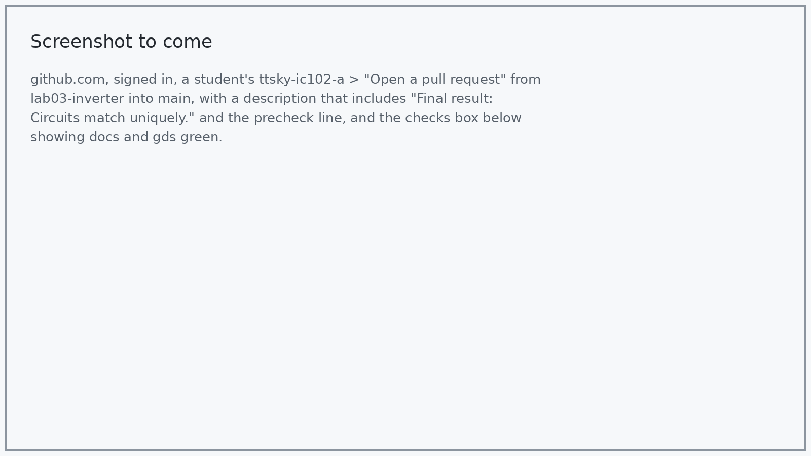
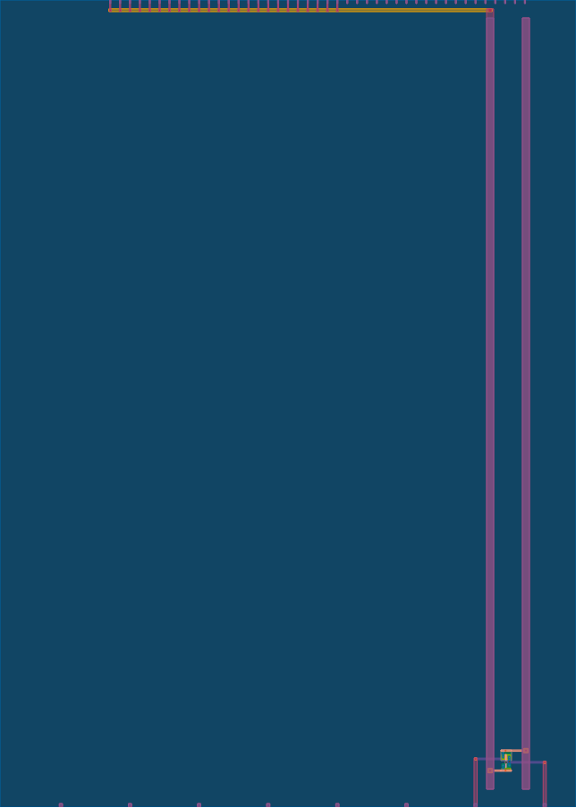

# Lab 03: A layout that passes precheck

You'll replace Lab 01's two stubs with a real circuit: the CMOS inverter from AD104 Lab 03,
placed in your 1x2 tile, with its input on `ua[0]` and its output on `ua[1]`. The course gives
you the cell and most of its wiring. You move the power stripes and draw the output wire yourself,
then check the result three ways: with Magic DRC, with precheck, and with LVS, which precheck
doesn't do. The change goes into `main` through a pull request in your own repository.

Package: [`labs/lab-03-a-layout-that-passes-precheck/`](https://github.com/uoftasic/ic102-a/tree/main/labs/lab-03-a-layout-that-passes-precheck)

## Before you start

- Read [The analog layout kit](../guide/the-analog-layout-kit.md),
  [What precheck checks](../guide/what-precheck-checks.md) and
  [Your tools and the runner's tools](../guide/your-tools-and-the-runners-tools.md).
- Finish [Lab 02](lab-02-read-the-red-x-overview.md), with both workflows green on `main`.
- You don't need to have taken AD104. The cell is DRC and LVS clean as it comes, and you won't
  change it.

This lab takes about 1 h 45 min.

## Part 1: A branch and a cell

Start the change on a branch of its own, so that it reaches `main` only through a pull request.

1. Make the branch and add the lab's files:

   ```bash
   cd /foss/designs/projects/ttsky-ic102-a
   git switch -c lab03-inverter
   /foss/designs/modules/ic102-a/labs/lab-03-a-layout-that-passes-precheck/start.sh .
   ```

   You should see:

   ```
   Added the inverter and its wiring to /foss/designs/projects/ttsky-ic102-a/layout:
    M layout/wires.tcl
   ?? layout/cells/
   ?? layout/lvs/
   ```

2. Read the new `layout/wires.tcl` from the top. It places the cell, `layout/cells/ic102_inv.mag`,
   at (140, 10) µm; runs each of its supply rails sideways on metal 1 and up a stack of vias to a
   power stripe on metal 4; and carries the input `A` east on metal 2 to `ua[0]`, up to metal 4 and
   down to the pin. Near the end there's a TODO where the output wire belongs, and the last line,
   `tieoff 136`, ties the 24 digital outputs to ground.

3. Look at `layout/lvs/reference.spice`, the circuit the finished tile should contain. Find the
   one line that says what the inverter connects to, and the 24 lines that tie outputs to `VGND`.

Check: `git status` shows the three changes above, and you're on `lab03-inverter`.

## Part 2: The power stripes

Where do the stripes have to be, and are they legal there?

1. `wires.tcl` expects a VGND stripe from x = 136 to 138 µm and a VDPWR stripe from 146 to 148 µm,
   on either side of the cell. The kit's script draws its stripes at 1 and 4 µm. Open
   `layout/init.tcl` and change its settings block to:

   ```tcl
   set POWER_STRIPES {
       VDPWR 146um
       VGND  136um
   }
   ```

2. Before you build, check the stripes against Tiny Tapeout's rules for analog power pins: "vertical
   stripes on met4" that "Start within the bottom 10 µm of the module and extend at least to the top
   10 µm", with a "Minimum width of 1.2 um". Read `draw_power_stripe` in `init.tcl` and write down
   where each stripe starts and ends, how wide it is, and whether it passes. The tile is 225.76 µm
   tall.

   <details>
   <summary>Answer</summary>

   `draw_power_stripe` draws a box from y = 5 µm to 220.76 µm, `POWER_STRIPE_WIDTH` (2 µm) wide,
   starting at the x you give it. 5 µm is within the bottom 10 µm, 220.76 µm is above
   225.76 − 10 = 215.76 µm, and 2 µm is more than 1.2 µm, so both stripes pass. Precheck checks
   the stripes too, in its pin check, against the template.

   </details>

3. Run `make`, then `make view` to look at the result in Magic on the desktop. You should see the
   tile, its two new stripes in the right-hand third, and the cell between them, near the bottom
   edge.

   {width=640}

Check: `make` ends with `wrote gds/tt_um_yourname_ic102.gds and lef/tt_um_yourname_ic102.lef`.

## Part 3: The output wire

Can you draw a wire that DRC, LVS and precheck all accept?

1. First see what the checks say about the layout as it is, with the TODO still open. Run
   `make lvs`. You should see:

   ```
   magic: extract a netlist from gds/tt_um_yourname_ic102.gds
   netgen: the extracted netlist against layout/lvs/reference.spice
     Final result: Top level cell failed pin matching.
     (no pin, node is inv0/Y)                   |ua[1]                                      
     ua[1]                                      |(no matching pin)                          
   full report: layout/build/lvs.report
   ```

   The left column is your layout and the right column is the reference. The reference has a pin
   `ua[1]` on the inverter's output, while in your layout the inverter's output, `inv0/Y`, isn't
   connected to any pin at all. Precheck sees the same gap in its own way: `make precheck` fails
   one check:

   ```
   | Analog pin check | ❌ Fail: Analog pin `ua[1]` is not connected to any adjacent metal but `analog_pins` is set to 2 in `info.yaml`. Either wire up `ua[1]` to your design or decrease `analog_pins` to 1. |
   ```

2. Work out the wire on paper before you type anything, using `A`'s wire in `wires.tcl` as the
   pattern. You need four things: a point on `Y`'s locali strip for the contact (the strip runs
   from x = 142.18 to 142.55 µm and y = 11.45 to 14.17 µm once the cell is placed); a y for the
   metal 2 that keeps it at least 0.14 µm from `A`'s metal 2 at y = 12.3 to 12.75; `ua[1]`'s x,
   132.49 to 133.39 µm; and a metal 4 wire from the via stack down to y = 0. Write the coordinates
   down.

3. Type the wire into the TODO in `layout/wires.tcl`, one `p` command per rectangle, in the same
   order as `A`'s: the locali pad, `mcon`, the metal 1 pad and `via1` at the contact; the metal 2
   wire; the metal 2 and metal 3 pads, `via2` and `via3` at `ua[1]`; the metal 4 wire. Keep the
   via rectangles at least as big as `A`'s, because in Magic a via rectangle includes the metal
   around its cut.

4. Run `make` and `make drc`. You should see `Magic DRC on gds/tt_um_yourname_ic102.gds: 0 errors`.
   If you get errors, the report names the rule, such as
   `Metal2 overlap of Via1 < 0.03um in one direction (met2.5 - met2.4)`; fix the rectangle it's
   about and run both again.

5. Run `make lvs`. You should see:

   ```
     Final result: Circuits match uniquely.
   ```

6. Run `make precheck`. You should see `Precheck passed` and all 15 checks ✅.

   If you're stuck, `solutions/wires.tcl` in the lab's package has one answer. Yours can differ
   from it in every number and still be right, as long as it passes the three checks.

Check: 0 DRC errors, `Circuits match uniquely.`, and precheck passed, all on the same build.

## Part 4: What precheck doesn't see

Which of the three checks catches a short between the input and the output?

1. Make a mistake on purpose. In your wire, change the bottom edge of `Y`'s long metal 2 rectangle
   so that it reaches down into `A`'s, which runs at y = 12.3 to 12.75. In the reference solution
   that's changing `p metal2 132.64 13.26 142.6 13.71` to `p metal2 132.64 12.6 142.6 13.71`. The
   two wires are now one piece of metal.

2. Before you run anything, write down which of `make drc`, `make lvs` and `make precheck` will
   complain.

3. Run `make`, then the three checks. In the reference solution with that change, you should see
   `Magic DRC on gds/tt_um_yourname_ic102.gds: 0 errors`, precheck passing all 15 checks, and LVS
   failing:

   ```
     Final result: Top level cell failed pin matching.
     (no matching net)                          |Net: ua[1]                                 
     (no pin, node is ua[0])                    |ua[1]                                      
     Number of nets: 3 **Mismatch**             |Number of nets: 4 **Mismatch**             
   ```

   <details>
   <summary>Why do DRC and precheck both pass?</summary>

   The metal itself is legal: it's wide, well clear of everything else, and joined properly. It's
   just connected to the wrong thing, and neither DRC nor any of precheck's 15 checks compares the
   layout with what it's meant to be. LVS does: the extracted circuit has the inverter's `A` and
   `Y` on one net, called `ua[0]`, where the reference has them on two. So run LVS yourself, every
   time, before you push a layout.

   </details>

4. Put the number back, and run `make`, `make lvs` and `make precheck` until you're back to
   `Circuits match uniquely.` and a pass.

5. Next, try a quicker mistake: comment out the `tieoff 136` line, run `make`,
   `make lvs` and `make precheck`, and compare. LVS lists the 24 output pins as unmatched, and
   precheck passes again. Tiny Tapeout's analog specs say
   "Connect any unused uo_out, uio_out and uio_oe pins to GND", but no automatic check holds you
   to it. Put the line back and rebuild.

Check: you're back to a layout that passes all three, and you can say which check caught each
mistake.

## Part 5: Through a pull request

How does a layout change get into `main` in a way someone else can check?

1. Update the pinout to match the new circuit: in `info.yaml`, describe `ua[0]` and `ua[1]` as the
   inverter's input and output, and update `docs/info.md`. Run `make docs`.

2. Commit everything on the branch. `git status` should show `info.yaml`, `docs/info.md`,
   `layout/init.tcl`, `layout/wires.tcl`, the two new folders under `layout/`, and the GDS and LEF.
   Then push the branch:

   ```bash
   git add -A
   git commit -m "Place the AD104 inverter between ua[0] and ua[1]"
   git push -u origin lab03-inverter
   ```

3. On GitHub, open a pull request from `lab03-inverter` into `main`. Your workflows run on every
   push, so the branch already has a `docs` and a `gds` run, and the pull request shows their
   results. In the description, say what changed, and paste the `Final result` line of
   `make lvs` and the `Precheck passed` line of `make precheck`. (Paste that line rather than
   precheck's last line, which is only the path of its reports.) LVS doesn't run on GitHub, so
   the reviewer has no other way to know that you ran it.

   {width=760}

4. When the branch's `gds` run is green in all three jobs, merge the pull request. The merge is a
   push to `main`, so both workflows run again; wait for them.

5. Download the `gds_render` artifact from the merge's `gds` run and open the PNG. You should see
   your tile as Tiny Tapeout renders it. The inverter is 3 µm wide in a 161 µm tile, so it's a
   speck near the bottom right, with its short wires down to `ua[0]` and `ua[1]`. At this scale
   the two stripes stand out, and so does the strap along the top edge that ties the 24 outputs
   to VGND.

   {width=320}

   ![The same render, close up: the cell between its two stripes, the two supply stacks, and the input and output wires running out to ua[0] (right) and ua[1] (left).](../assets/img/ic102-a-render-inverter-zoom.png){width=640}

Check: the pull request is merged, and the `gds` run on the merge commit is green.

## Finishing

You're done when the merge commit on your `main` has a green `gds` run, with `gds`, `precheck` and
`viewer` all passed, and `make lvs` on that commit prints `Final result: Circuits match uniquely.`

Questions:

1. Suppose you'd left the stripes where the kit puts them, VDPWR at 1 µm and VGND at 4 µm, and
   built the reference solution's `wires.tcl` as it is. Which checks would fail?

   <details>
   <summary>Answer</summary>

   We tried it: precheck passes all 15 checks, because the stripes are just as legal at 1 and
   4 µm, and LVS fails. The cell's two via stacks now land on empty space at x = 136 and 146 µm, so
   the inverter's supplies connect to nothing, and neither do the 24 tied outputs, whose strap
   ends at the same empty spot. `make lvs` starts its list with
   `(no pin, node is inv0/VPWR)                |VDPWR` and goes on to the 24 outputs.

   </details>

2. Your pull request's diff of `gds/tt_um_yourname_ic102.gds` says only that a binary file
   changed. What in the pull request lets a reviewer judge the layout?

   <details>
   <summary>Answer</summary>

   The text files that built it (`wires.tcl`, `init.tcl`'s settings, the reference netlist), the
   runs' results, precheck's table, the `gds_render` picture, and the LVS line you pasted. In
   Lab 04 you review a layout change from those.

   </details>

Submit: nothing for this lab.

Next on the [Course path](../index.md#course-path): read [Pull requests and review](../guide/pull-requests-and-review.md),
[Branch rules](../guide/branch-rules.md), [Layout files in git](../guide/layout-files-in-git.md)
and [How open-source projects work](../guide/how-open-source-projects-work.md), then do
[Lab 04: A change through review](lab-04-a-change-through-review-overview.md).
