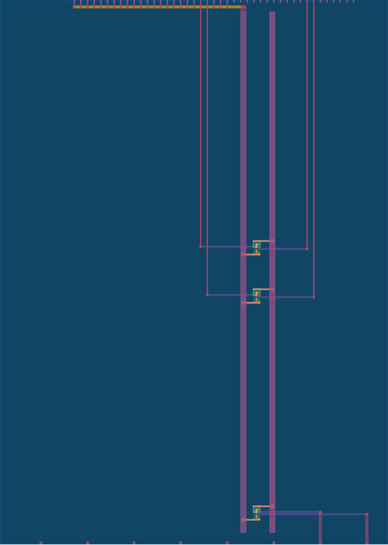

# Lab 04: A change through review

You'll make a change to a layout that the whole cohort shares, and get it into `main` the way the
team's projects should: a pull request with a description, checks that pass, and an approval from
a classmate who reviewed it. You'll review a classmate's pull request in return, and resolve a
conflict when someone else's change gets merged before yours.

Package: [`labs/lab-04-a-change-through-review/`](https://github.com/uoftasic/ic102-a/tree/main/labs/lab-04-a-change-through-review)

## Before you start

- Read [Pull requests and review](../guide/pull-requests-and-review.md),
  [Branch rules](../guide/branch-rules.md), [Layout files in git](../guide/layout-files-in-git.md)
  and [How open-source projects work](../guide/how-open-source-projects-work.md).
- Finish [Lab 03](lab-03-a-layout-that-passes-precheck-overview.md). You'll copy your inverter
  cell from it.
- Get your cohort's sandbox link from your TA. It's a repository in the `uoftasic` organization,
  such as `uoftasic/ic102a-sandbox-2027w`, made from
  [`labs/lab-04-a-change-through-review/sandbox/`](https://github.com/uoftasic/ic102-a/tree/main/labs/lab-04-a-change-through-review/sandbox).
  Read its `README.md` and `REVIEWING.md`.

This lab takes about 1 h of your own time, spread over a day or two, because it depends on your
classmates: you can't approve your own pull request, and the conflict in Part 5 only happens once
someone else's has been merged.

## Part 1: Your fork

Set up a copy of the sandbox you can push to.

1. The sandbox is a small analog project with the inverter from Lab 03 between `ua[0]` and
   `ua[1]`, and eight empty slots. Slot K holds one more inverter, with its input on `ui_in[K]`
   and its output on `uo_out[K]`. Open its `main` branch on GitHub and read `layout/slots.tcl`
   to see which slots are taken.

2. Click **Fork** on the sandbox's page and create a fork under your own account. Your fork is
   yours to push to; the sandbox's `main` changes only through pull requests, under the rules in
   its `RULESET.md`.

   <!-- SCREENSHOT-TODO: github.com, signed in, the cohort sandbox's page with the "Fork" button's "Create a new fork" page open, Owner set to a personal account and "Copy the main branch only" ticked. -->
   {width=640}

3. Clone your fork, set your identity in it, and add the sandbox as a second remote called
   `upstream`, so you can fetch what others merge:

   ```bash
   cd /foss/designs/projects
   git clone https://github.com/YOUR-USERNAME/SANDBOX.git
   cd SANDBOX
   git config user.name "Your Name"
   git config user.email "ID+USERNAME@users.noreply.github.com"
   git remote add upstream https://github.com/uoftasic/SANDBOX.git
   git remote -v
   ```

   `git remote -v` should list `origin` (your fork) and `upstream` (the sandbox), each twice.

4. Run `make` and `make precheck` before you change anything, so you know the sandbox builds on
   your machine. You should see `Precheck passed` and all 15 checks ✅.

Check: `make precheck` passes on an unchanged clone of your fork.

## Part 2: Claim a slot

What does a layout change look like when you can't read it in a diff?

1. Pick a free slot, K, from 0 to 7. Look at the open pull requests on the sandbox as well as
   `layout/slots.tcl`, so you don't pick one a classmate is already claiming. Make a branch:

   ```bash
   git switch -c slot-K-YOUR-USERNAME
   ```

2. Make the change, with `you` standing for your GitHub username with any `-` changed to `_`:

   - Copy your cell from Lab 03:
     `cp ../ttsky-ic102-a/layout/cells/ic102_inv.mag layout/cells/inv_you.mag`.
   - Add one line to the end of `layout/slots.tcl`: `slot K inv_you`.
   - In `info.yaml`'s pinout, describe `ui[K]` and `uo[K]`, for example
     `"you's inverter, input"` and `"you's inverter, output"`.

3. Run `make`, `make lvs` and `make precheck`. You should see `wrote gds/tt_um_uoftasic_ic102a_sandbox.gds ...`,
   then `Final result: Circuits match uniquely.`, then `Precheck passed` with all 15 checks ✅.
   `make lvs` checks the layout against a reference that `layout/lvs/reference.py` writes from
   `slots.tcl`, so your slot is in it.

4. Commit, and look at what you're about to ask someone to review:

   ```bash
   git add -A
   git commit -m "Claim slot K for YOUR-USERNAME's inverter"
   git show --stat HEAD
   ```

   Here's the same change for a student called `alice` in slot 3, from a rehearsal of this lab:

   ```
    gds/tt_um_uoftasic_ic102a_sandbox.gds | Bin 19736 -> 24794 bytes
    info.yaml                             |   4 +-
    layout/cells/inv_alice.mag            | 116 ++++++++++++++++++++++++++++++++++
    layout/slots.tcl                      |   1 +
    lef/tt_um_uoftasic_ic102a_sandbox.lef |  57 +++++++++--------
    5 files changed, 148 insertions(+), 30 deletions(-)
   ```

   <details>
   <summary>Which of these lines can a reviewer actually read?</summary>

   `slots.tcl` and `info.yaml`, five changed lines between them. The cell is 116 lines of Magic's
   format, which nobody reviews line by line, and which is a copy of a cell that already passed
   LVS. The GDS is binary, shown only as a change of size. The LEF is text, but it's generated, so
   its 57 lines say nothing a reviewer can act on. That's why your description has to carry the
   evidence, and why the reviewer looks at the render and the precheck table, as
   [Layout files in git](../guide/layout-files-in-git.md) says.

   </details>

Check: one commit on your branch that changes those five files, and nothing else.

## Part 3: Open the pull request

1. Push your branch to your fork, `git push -u origin slot-K-YOUR-USERNAME`, and GitHub prints a
   link for opening a pull request. Open one into the sandbox's `main`.

2. The description starts from the sandbox's template. Fill it in: which slot, the cell's name,
   and the last lines of `make precheck` and `make lvs` from your latest commit. If an AI tool
   wrote part of the change or the description, say which part, and what you checked yourself.

3. Watch the checks. The sandbox's workflows run on `pull_request`, which the analog template
   doesn't have; [The analog workflows](../guide/the-analog-workflows.md#the-sandbox-is-different)
   explains why the sandbox needs it. You should see `docs`, `gds` and `precheck` run and pass, and
   `viewer` skipped. The merge box says merging is blocked until someone approves.

   <!-- SCREENSHOT-TODO: github.com, signed in, a pull request in the cohort sandbox with docs, gds and precheck green and viewer skipped, and the merge box saying "Review required" / "Merging is blocked" with the ruleset's name. -->
   {width=760}

   <!-- RUN-TODO: a pull_request run in a real cohort sandbox; confirm that viewer shows as skipped and that the required checks are named docs, gds and precheck in the merge box. -->

4. Ask in the cohort's channel for a reviewer.

Check: your pull request is open, its three checks are green, and it's waiting for a review.

## Part 4: Review a classmate's

Can you tell, without reading the GDS, whether a layout change is what its description says?

1. Pick a classmate's open pull request that nobody has reviewed yet, and go through
   `REVIEWING.md` from the top. Note what you checked, with the evidence for each line.

2. Download the `gds_render` artifact from its latest `gds` run and open the PNG. Slot K sits at
   y = 40 + 20K µm, between the two stripes. You should see one more inverter than `main` has,
   with a wire up to the top edge on each side. Here's the sandbox with slots 3 and 4 claimed,
   rendered the same way:

   {width=360}

3. Compare the slot in the render with the line in `slots.tcl` and the two pinout lines. A
   description that says slot 5 for a pinout that describes `ui[4]` is exactly the kind of mistake
   precheck can't see: it doesn't read the digital pins' descriptions at all.

4. Write the review: **Review changes** › **Request changes**, with a comment that says what
   should change and why, or **Approve** if there's nothing. There usually is something, even if
   it's only a description that's missing the LVS line. Requests have to be specific: "Paste the
   `Final result` line of `make lvs` from the latest commit" can be acted on; "looks off" can't.

   <!-- SCREENSHOT-TODO: github.com, signed in, a pull request in the cohort sandbox > Files changed > "Review changes" dialog open, with a comment typed and "Request changes" selected. -->
   {width=640}

5. When the author pushes the change, look again. The sandbox's ruleset dismisses earlier approvals
   on a new push and wants the last push approved by someone other than its author, so approve it
   once it's right.

Check: you've submitted a review that requests a specific change, and approved after the author
made it.

## Part 5: When main moves

What happens to your pull request when someone else's is merged first?

1. Once a classmate's pull request has been merged, look at yours. You should see "This branch has
   conflicts that must be resolved", and no new runs: GitHub's documentation says "Workflows will
   not run on `pull_request` activity if the pull request has a merge conflict."

2. Before you merge, predict which of your five changed files will conflict, and why. Then bring
   the sandbox's `main` into your branch:

   ```bash
   git fetch upstream
   git merge upstream/main
   ```

   In the rehearsal, `bob`, in slot 4, did this after `alice`'s slot 3 had been merged, and saw:

   ```
   warning: Cannot merge binary files: gds/tt_um_uoftasic_ic102a_sandbox.gds (HEAD vs. upstream/main)
   Auto-merging gds/tt_um_uoftasic_ic102a_sandbox.gds
   CONFLICT (content): Merge conflict in gds/tt_um_uoftasic_ic102a_sandbox.gds
   Auto-merging info.yaml
   CONFLICT (content): Merge conflict in info.yaml
   Auto-merging layout/slots.tcl
   CONFLICT (content): Merge conflict in layout/slots.tcl
   Auto-merging lef/tt_um_uoftasic_ic102a_sandbox.lef
   CONFLICT (content): Merge conflict in lef/tt_um_uoftasic_ic102a_sandbox.lef
   Automatic merge failed; fix conflicts and then commit the result.
   ```

   <details>
   <summary>Why does info.yaml conflict when the two of them described different pins?</summary>

   git compares changes line by line, and treats two changes to neighbouring lines as one
   conflict, because it can't know whether they depend on each other. `ui[3]` and `ui[4]` are
   next to each other in the pinout:

   ```
   <<<<<<< HEAD
     ui[3]: ""
     ui[4]: "bob's inverter, input"
   =======
     ui[3]: "alice's inverter, input"
     ui[4]: ""
   >>>>>>> upstream/main
   ```

   and `slots.tcl` conflicts because both added a line at its end.

   </details>

3. Resolve the two text files by hand, keeping both sides' claims: in `info.yaml`, each pin line
   keeps whichever side has a description; in `layout/slots.tcl`, keep both `slot` lines, in slot
   order. Delete every `<<<<<<<`, `=======` and `>>>>>>>` line.

4. Don't resolve `gds/` or `lef/` at all. Run `make`, which builds both again from the merged
   sources, then check and commit:

   ```bash
   make && make lvs && make precheck
   git add info.yaml layout/slots.tcl gds lef
   git commit -m "Merge main into slot-K-YOUR-USERNAME"
   git push
   ```

   If `make` stops with `make: can't read project.top_module from info.yaml`, there's a conflict
   marker left in `info.yaml`. If it stops with
   `Error parsing "../build.tcl": slot 3 is claimed twice in slots.tcl`, you and a classmate
   claimed the same slot, and whoever was merged second picks another, in `slots.tcl` and
   `info.yaml` both.

5. Your pull request's checks run again on the new commit. Because you pushed, your approval was
   dismissed, so ask your reviewer to look again.

Check: your branch has a merge commit, `make lvs` matches and `make precheck` passes on it, and
the pull request shows no conflict.

## Part 6: Merge

1. When your pull request has an approval for its latest push and green checks, merge it with
   **Create a merge commit**. The merge is a push to the sandbox's `main`, so its workflows run
   there, `viewer` included, and the sandbox's Pages site shows the new layout.

2. Look at the sandbox's history: `git fetch upstream` and `git log --oneline --graph upstream/main`.
   Your claim, your merge of `main` and the pull request's merge are all there, with the review on
   GitHub to go with them.

## Finishing

You're done when your pull request in the cohort sandbox has been merged after an approval, and
one of your reviews on a classmate's pull request requested a change that its author then made.

Questions:

1. In Part 5 you rebuilt `gds/` with `make` instead of picking one side's file. What would have
   been wrong with `git checkout --theirs gds/`?

   <details>
   <summary>Answer</summary>

   "Theirs" is `main`'s GDS, which has the other student's slot and not yours; "ours" has yours
   and not theirs. Neither is the layout of the merged sources. The only correct GDS is one built
   from the merged `slots.tcl`, which is what `make` does. A GDS committed from the wrong side would
   still pass precheck, because both sides are legal layouts, so nothing on GitHub would tell you.

   </details>

2. The ruleset requires `docs`, `gds` and `precheck` but not `viewer`. Why?

   <details>
   <summary>Answer</summary>

   `viewer` is skipped on pull requests, so it never reports on one. It runs when the merge is
   pushed to `main`.

   </details>

Submit: nothing for this lab. Your pull request and your review are the record.

Next on the [Course path](../index.md#course-path): read [History as evidence](../guide/history-as-evidence.md),
then do [Lab 05: Find the commit that broke it](lab-05-find-the-commit-that-broke-it-overview.md).
