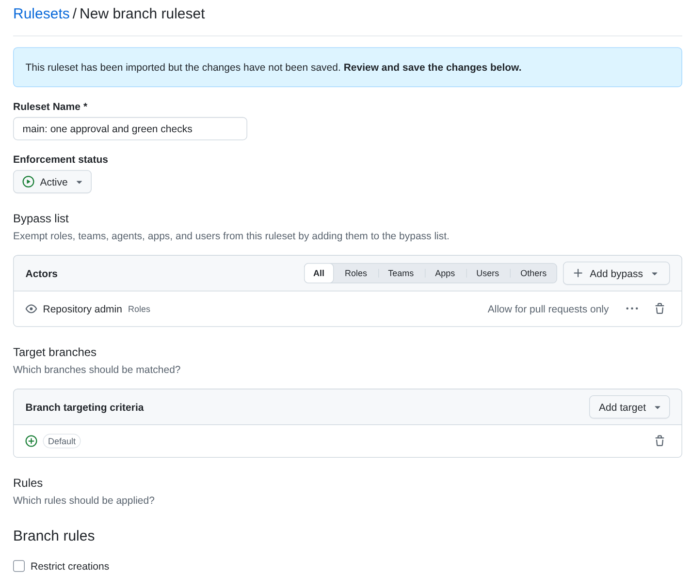
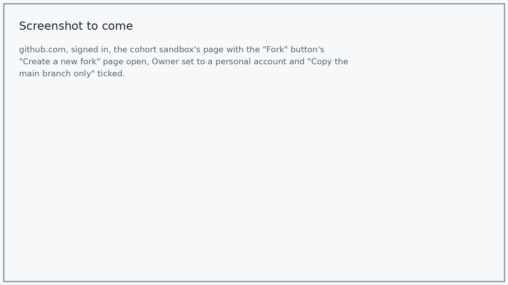
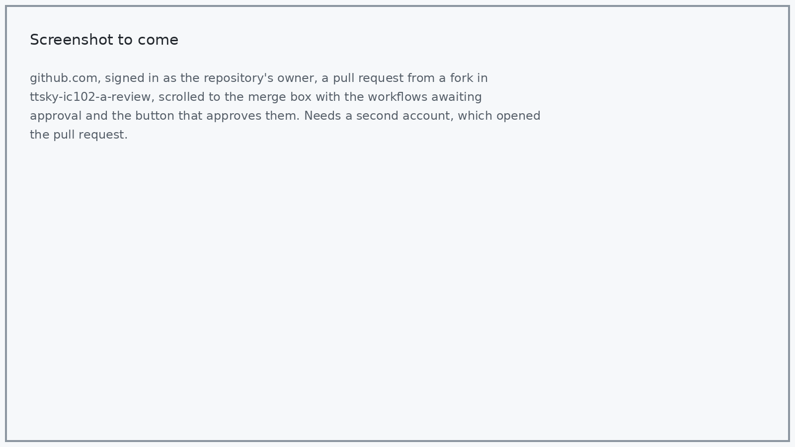
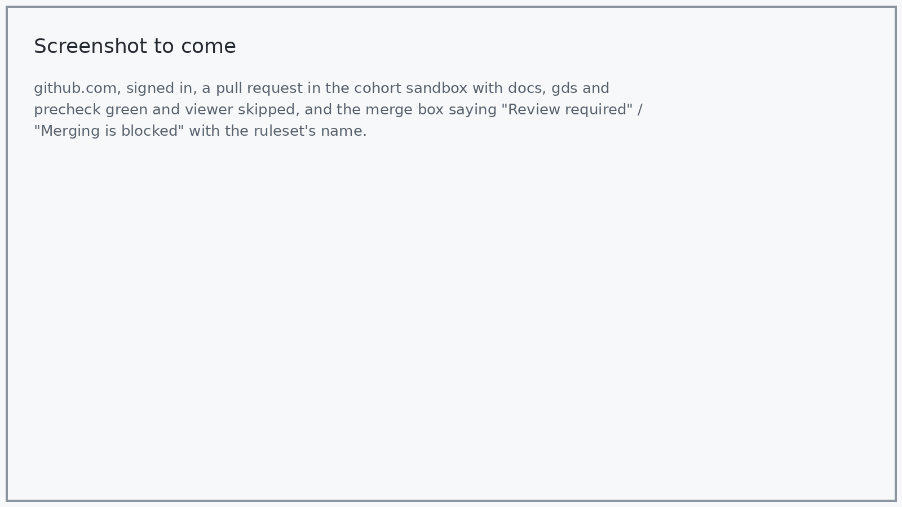
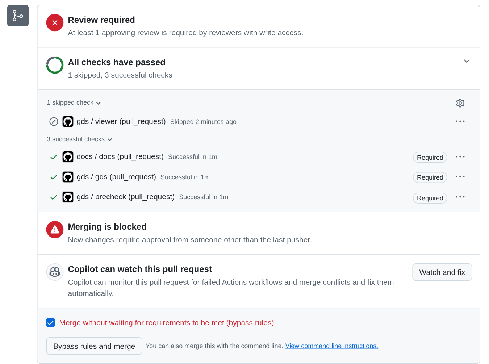
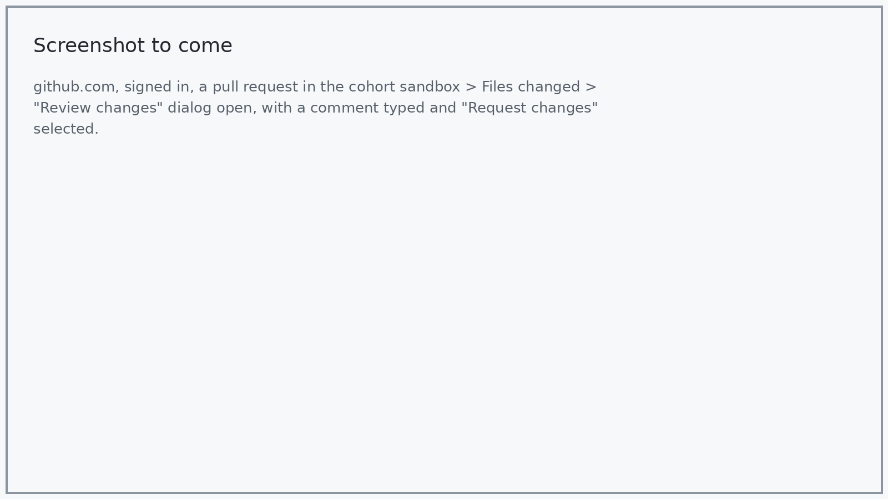

# Lab 04: A change through review

You and a partner each make a review repository from the course's sandbox, a small analog project
with eight empty slots for an inverter. You'll claim a slot in your partner's repository through a
pull request from a fork, and review the one your partner opens in yours. Because you also claim
the slot next to theirs in your own repository, their pull request will conflict with `main`, and
they'll resolve it the way a layout repository needs.

Package: [`labs/lab-04-a-change-through-review/`](https://github.com/uoftasic/ic102-a/tree/main/labs/lab-04-a-change-through-review)

## Before you start

- Read [Pull requests and review](../guide/pull-requests-and-review.md),
  [Branch rules](../guide/branch-rules.md), [Layout files in git](../guide/layout-files-in-git.md)
  and [How open-source projects work](../guide/how-open-source-projects-work.md).
- Finish [Lab 03](lab-03-a-layout-that-passes-precheck-overview.md). You'll copy your inverter
  cell from your `ttsky-ic102-a` repository.
- Find a partner who is taking IC102-A, and swap GitHub usernames. You both do every part: Parts 1,
  3, 4 and 6 in your own repository, as its owner, and Parts 2 and 5 in your partner's, as a
  contributor.
- Your token from Lab 01, Part 2 already covers the two repositories you'll make here, because it
  was made for "All repositories".

This lab takes about 1 h 30 min of your own time, spread over a day or two, because each of you
waits for the other: your partner's pull request has to be open before Part 3, and yours can only
merge once your partner approves it.

## Part 1: Your review repository

Set up the repository your partner will send a pull request to, with rules on its `main`.

1. On GitHub, make a new repository (the **+** menu › **New repository**) with your own account as
   the owner, the name `ttsky-ic102-a-review`, **Public**, and no README, `.gitignore` or licence,
   so that it starts empty.

2. Copy the sandbox into your projects folder, make it a git repository, and push it:

   ```bash
   mkdir -p /foss/designs/projects && cd /foss/designs/projects
   cp -r /foss/designs/modules/ic102-a/labs/lab-04-a-change-through-review/sandbox ttsky-ic102-a-review
   cd ttsky-ic102-a-review
   git init -b main
   git config user.name "Your Name"
   git config user.email "ID+USERNAME@users.noreply.github.com"
   git config credential.helper 'cache --timeout=28800'
   git add -A
   git commit -m "Start from the IC102-A sandbox"
   git remote add origin https://github.com/YOUR-USERNAME/ttsky-ic102-a-review.git
   git push -u origin main
   ```

   You should see `[main (root-commit) ...] Start from the IC102-A sandbox` and `25 files changed`.
   This push adds files under `.github/workflows/`, which is why the token needs the Workflows
   permission as well as Contents.

3. The push starts the `docs` and `gds` workflows, and `viewer` fails with the 404 from Lab 01,
   because Pages is off in a new repository. Turn it on (Settings › Pages › Source: **GitHub
   Actions**), then start a new run: Actions › `gds` › **Run workflow** on `main`. As in Lab 01,
   don't use "Re-run failed jobs" for this. You should see `docs` green, and `gds`, `precheck` and
   `viewer` green in the new run.

   <!-- RUN-TODO: the first runs of a student's ttsky-ic102-a-review: the push's docs and gds runs (viewer red with the Pages 404) and the Run workflow run after Pages is on, all three jobs green. One account is enough. -->

4. Add the rules. Open Settings › Rules › Rulesets › **New ruleset** › **Import a ruleset**, and
   choose `ruleset.json` from your clone; on your own computer it's in your workspace folder, under
   `projects/ttsky-ic102-a-review/`. Check what the page shows against the table in `RULESET.md`,
   then press **Create**.

   <!-- SCREENSHOT-TODO: github.com, signed in, YOUR-USERNAME/ttsky-ic102-a-review > Settings > Rules > Rulesets, the ruleset imported from ruleset.json before Create: name "main: one approval and green checks", Enforcement Active, target Default, and the Bypass list showing "Repository admin" with "For pull requests only". One account is enough. -->
   {width=640}

5. You're the repository's admin, and the admin role is on the bypass list. Before you try it,
   write down whether a commit pushed straight to `main` will be accepted. Then try one that
   changes nothing, and throw it away afterwards:

   ```bash
   git commit --allow-empty -m "Try to push to main"
   git push
   git reset --hard origin/main
   ```

   <!-- RUN-TODO: the full output of `git push` when the ruleset refuses a direct push to main (the GH013 rule-violation lines), from a student's ttsky-ic102-a-review. One account is enough. -->

   <details>
   <summary>Answer</summary>

   It's refused, and GitHub's message names the rule that requires a pull request. The bypass is
   "For pull requests only": it lets you merge a pull request of your own without an approval
   (you'll use that in Part 3), and nothing else.

   </details>

6. Send your partner the address of your repository.

Check: a green `gds` run on `main` with all three jobs, an active ruleset, and a refused push.

## Part 2: Claim a slot in your partner's repository

What does a layout change look like when you can't read it in a diff?

1. Open `https://github.com/PARTNER-USERNAME/ttsky-ic102-a-review` and click **Fork**. Leave
   "Copy the main branch only" ticked, and change the repository name to
   `ttsky-ic102-a-review-fork`, because you already have a repository called
   `ttsky-ic102-a-review`.

   <!-- SCREENSHOT-TODO: github.com, signed in, the "Create a new fork" page for PARTNER-USERNAME/ttsky-ic102-a-review: Owner set to a personal account, Repository name changed to ttsky-ic102-a-review-fork, "Copy the main branch only" ticked. Needs a second account, whose repository is forked. -->
   {width=640}

2. Clone your fork, set it up as you did your own, and add your partner's repository as a second
   remote called `upstream`, so you can fetch what they merge:

   ```bash
   cd /foss/designs/projects
   git clone https://github.com/YOUR-USERNAME/ttsky-ic102-a-review-fork.git
   cd ttsky-ic102-a-review-fork
   git config user.name "Your Name"
   git config user.email "ID+USERNAME@users.noreply.github.com"
   git config credential.helper 'cache --timeout=28800'
   git remote add upstream https://github.com/PARTNER-USERNAME/ttsky-ic102-a-review.git
   git remote -v
   ```

   `git remote -v` should list `origin` (your fork) and `upstream` (your partner's repository),
   each twice.

3. Pick a slot, K, from 0 to 7, and tell your partner which one. Make a branch for it:

   ```bash
   git switch -c slot-K-YOUR-USERNAME
   ```

4. Make the change, with `you` standing for your GitHub username with any `-` changed to `_`:

   - Copy your cell from Lab 03:
     `cp ../ttsky-ic102-a/layout/cells/ic102_inv.mag layout/cells/inv_you.mag`.
   - Add one line to the end of `layout/slots.tcl`: `slot K inv_you`.
   - In `info.yaml`'s pinout, describe `ui[K]` and `uo[K]`, for example
     `"you's inverter, input"` and `"you's inverter, output"`.

5. Run `make`, `make lvs` and `make precheck`. You should see
   `wrote gds/tt_um_ic102a_sandbox.gds and lef/tt_um_ic102a_sandbox.lef`, then
   `Final result: Circuits match uniquely.`, then `Precheck passed` with all 15 checks ✅.
   `make lvs` checks the layout against a reference that `layout/lvs/reference.py` writes from
   `slots.tcl`, so your slot is in it.

6. Commit, and look at what you're about to ask someone to review:

   ```bash
   git add -A
   git commit -m "Claim slot K for YOUR-USERNAME's inverter"
   git show --stat HEAD
   ```

   Here's the same change for a student called `bob` in slot 4, from a rehearsal of this lab:

   ```
    gds/tt_um_ic102a_sandbox.gds | Bin 19716 -> 24770 bytes
    info.yaml                    |   4 +-
    layout/cells/inv_bob.mag     | 116 +++++++++++++++++++++++++++++++++++++++++++
    layout/slots.tcl             |   1 +
    lef/tt_um_ic102a_sandbox.lef |  57 ++++++++++-----------
    5 files changed, 148 insertions(+), 30 deletions(-)
   ```

   <details>
   <summary>Which of these lines can a reviewer actually read?</summary>

   `slots.tcl` and `info.yaml`, five changed lines between them. The cell is 116 lines of Magic's
   format, which nobody reviews line by line, and which is a copy of a cell that already passed
   LVS. The GDS is binary, shown only as a change of size. The LEF is text, but it's generated, so
   its 57 lines say nothing a reviewer can act on. That's why your description has to carry the
   evidence, and why the reviewer looks at the render and the precheck table, as
   [Layout files in git](../guide/layout-files-in-git.md) says.

   </details>

7. Push the branch to your fork with `git push -u origin slot-K-YOUR-USERNAME`. git prints a link
   for opening a pull request; open it, and check that the base is your partner's repository and
   its `main`. Fill in the description from the template: which slot, the cell's name, and the last
   lines of `make lvs` and `make precheck`. If an AI tool wrote part of the change or the
   description, say which part, and what you checked yourself. Create the pull request and tell
   your partner its number.

Check: your pull request is open on your partner's repository, with one commit that changes those
five files.

## Part 3: Main moves

What happens to an open pull request when `main` changes under it?

1. Open your partner's pull request in your repository. Its checks haven't started, because GitHub
   holds the runs of anyone who has never had a change merged into a repository until someone with
   write access approves them. A `pull_request` run uses the workflow files from the pull request
   itself, so read **Files changed** first and check that nothing under `.github/` changed. Then
   approve the runs (**Approve workflows to run**, in GitHub's documentation).

   <!-- SCREENSHOT-TODO: github.com, signed in as the repository's owner, a pull request from a fork in ttsky-ic102-a-review, scrolled to the merge box with the workflows awaiting approval and the button that approves them. Needs a second account, which opened the pull request. -->
   {width=640}

   You should see `docs`, `gds` and `precheck` run and pass, and `viewer` skipped. The merge box
   says merging is blocked until the pull request is approved.

   <!-- SCREENSHOT-TODO: github.com, signed in, a pull request from a fork in ttsky-ic102-a-review with docs, gds and precheck green and viewer skipped, and the merge box saying review is required and merging is blocked. Needs a second account, which opened the pull request. -->
   {width=760}

   <!-- RUN-TODO: a pull_request run from a fork into a student's ttsky-ic102-a-review: confirm that viewer shows as skipped, that the required checks are named docs, gds and precheck in the merge box, and whether each later push to the pull request needs its runs approved again. Needs two accounts. -->

2. Now claim the slot next to your partner's in your own repository: if they took slot K, take
   K + 1, or K − 1 if they took 7. In your own clone (`cd /foss/designs/projects/ttsky-ic102-a-review`),
   make a branch with `git switch -c slot-J-YOUR-USERNAME`, with J your slot, and repeat Part 2's
   steps 4 to 6 there.

3. Push the branch with `git push -u origin slot-J-YOUR-USERNAME` and open a pull request into your
   own `main`. Wait for its three checks to go green.

4. Your partner can't approve it: only an approval from someone with write access counts, and on a
   repository in your account that's only you. Merge it yourself with the bypass: tick the box in
   the merge box that merges without waiting for the requirements, and choose
   **Create a merge commit**.

   <!-- SCREENSHOT-TODO: github.com, signed in as the owner, the owner's own pull request in ttsky-ic102-a-review with its checks green, scrolled to the merge box with the bypass checkbox ticked and "Create a merge commit". One account is enough. -->
   {width=640}

5. Before you look at your partner's pull request again, predict which of its five files will
   conflict with your `main` now. Then open it. You should see "This branch has conflicts that
   must be resolved", and no new runs, because GitHub's documentation says "Workflows will not run
   on `pull_request` activity if the pull request has a merge conflict."

   <!-- SCREENSHOT-TODO: github.com, signed in as the owner, the partner's pull request in ttsky-ic102-a-review with the merge box saying "This branch has conflicts that must be resolved" and listing the conflicting files. Needs a second account. -->

Check: your claim is merged into your `main`, and your partner's pull request shows a conflict.

## Part 4: Review your partner's pull request

Can you tell, without reading the GDS, whether a layout change is what its description says?

1. Go through `REVIEWING.md` from the top, and note what you checked, with the evidence for each
   line.

2. Download the `gds_render` artifact from the pull request's `gds` run and open the PNG. Slot K
   sits at y = 40 + 20K µm, between the two stripes. You should see one more inverter than the
   empty sandbox has, with a wire up to the top edge on each side. Here's a sandbox with slots 3
   and 4 claimed, rendered the same way:

   {width=360}

3. Run LVS on the pull request yourself. GitHub keeps every pull request's commits under a name in
   your repository, `pull/N/head`, so you can fetch them without adding your partner's fork:

   ```bash
   cd /foss/designs/projects/ttsky-ic102-a-review
   git fetch origin pull/N/head:pr-N
   git switch pr-N
   make lvs
   git switch main
   ```

   You should see `Final result: Circuits match uniquely.` if the slot is right.

4. Compare the slot in the render with the line in `slots.tcl` and the two pinout lines. A
   description that says slot 5 for a pinout that describes `ui[4]` is exactly the kind of mistake
   precheck can't see: it doesn't read the digital pins' descriptions at all.

5. Write the review: **Files changed** › **Review changes** › **Request changes**, with a comment
   that says what should change and why. There usually is something, even if it's only a
   description that's missing the LVS line. Requests have to be specific: "Paste the
   `Final result` line of `make lvs` from the latest commit" can be acted on; "looks off" can't.

   <!-- SCREENSHOT-TODO: github.com, signed in as the owner, a pull request from a fork in ttsky-ic102-a-review > Files changed > "Review changes" open, with a comment typed and "Request changes" selected. Needs a second account, which opened the pull request. -->
   {width=640}

Check: you've submitted a review on your partner's pull request that requests a specific change.

## Part 5: Answer the review, and resolve the conflict

What happens to an approval when you push again?

1. Back in your fork's clone, make the change your partner asked for, commit it, and push. Reply to
   each of their comments and resolve it, because the ruleset won't merge with a conversation still
   open. Ask your partner to look again; they can approve a pull request that has a conflict.

2. Once they've approved, bring their `main` into your branch. Predict which files will conflict
   first, then:

   ```bash
   git fetch upstream
   git merge upstream/main
   ```

   In the rehearsal, `bob` had claimed slot 4 and `alice`, the owner, then merged slot 5. `bob` saw:

   ```
   warning: Cannot merge binary files: gds/tt_um_ic102a_sandbox.gds (HEAD vs. upstream/main)
   Auto-merging gds/tt_um_ic102a_sandbox.gds
   CONFLICT (content): Merge conflict in gds/tt_um_ic102a_sandbox.gds
   Auto-merging info.yaml
   CONFLICT (content): Merge conflict in info.yaml
   Auto-merging layout/slots.tcl
   CONFLICT (content): Merge conflict in layout/slots.tcl
   Auto-merging lef/tt_um_ic102a_sandbox.lef
   CONFLICT (content): Merge conflict in lef/tt_um_ic102a_sandbox.lef
   Automatic merge failed; fix conflicts and then commit the result.
   ```

   <details>
   <summary>Why does info.yaml conflict when the two of them described different pins?</summary>

   git compares changes line by line, and treats two changes to neighbouring lines as one
   conflict, because it can't know whether they depend on each other. `ui[4]` and `ui[5]` are
   next to each other in the pinout:

   ```
   <<<<<<< HEAD
     ui[4]: "bob's inverter, input"
     ui[5]: ""
   =======
     ui[4]: ""
     ui[5]: "alice's inverter, input"
   >>>>>>> upstream/main
   ```

   `slots.tcl` conflicts because both added a line at its end, and the GDS and LEF because both
   sides rebuilt them.

   </details>

3. Resolve the two text files by hand, keeping both sides' claims: in `info.yaml`, each pin line
   keeps whichever side has a description; in `layout/slots.tcl`, keep both `slot` lines, in slot
   order. Delete every `<<<<<<<`, `=======` and `>>>>>>>` line.

4. Don't resolve `gds/` or `lef/` at all. Run `make`, which builds both again from the merged
   sources, check the result, then finish the merge and push:

   ```bash
   make && make lvs && make precheck
   git add info.yaml layout/slots.tcl gds lef
   git commit --no-edit
   git push
   ```

   The commit is `Merge remote-tracking branch 'upstream/main' into slot-K-YOUR-USERNAME`. If
   `make` stops with `make: can't read project.top_module from info.yaml`, there's a conflict
   marker left in `info.yaml`, and `make` lists the lines. If it stops with
   `Error parsing "../build.tcl": slot 3 is claimed twice in slots.tcl` (with your slot number),
   you and your partner claimed the same slot, and you pick another, in `slots.tcl` and
   `info.yaml` both.

5. The conflict is gone, so the checks run again on the new commit. Before you look, predict
   whether your pull request is still approved.

   <details>
   <summary>Answer</summary>

   No. The ruleset dismisses an approval when new commits arrive, because your partner approved
   the commits they saw, and the merge you pushed is a new layout that neither of you has
   reviewed. Ask them to look again.

   </details>

Check: your branch has a merge commit, `make lvs` matches and `make precheck` passes on it, and
the pull request shows no conflict.

## Part 6: Approve and merge

1. When your partner has pushed their merge, look at their pull request again: the checks, the
   new render, and the `slots.tcl` and pinout lines, which now hold both claims. When it's right,
   approve it and merge it with **Create a merge commit**; your partner can't, having no write
   access to your repository. The merge is a push to `main`, so the workflows run there, `viewer`
   included, and your Pages site shows the layout with both slots.

2. Look at your repository's history:

   ```bash
   cd /foss/designs/projects/ttsky-ic102-a-review
   git switch main
   git pull
   git log --oneline --graph
   ```

   In the rehearsal it looked like this, with the oldest commit at the bottom:

   ```
   *   a265da4 Merge pull request #1 from bob/slot-4-bob
   |\
   | *   64ea717 Merge remote-tracking branch 'upstream/main' into slot-4-bob
   | |\
   | |/
   |/|
   * |   d5d5e2a Merge pull request #2 from alice/slot-5-alice
   |\ \
   | * | fe2e3cc Claim slot 5 for alice's inverter
   |/ /
   | * 5bfcf29 Claim slot 4 for bob's inverter
   |/
   * 6eda35f Start from the IC102-A sandbox
   ```

Check: your partner's pull request is merged, and the `gds` run on your `main` is green with all
three jobs.

## Part 7: A pull request written by an AI tool (optional)

About 20 minutes. The package has a pull request that an AI coding tool wrote, with problems the
course left in it on purpose, and every check passes on it. Each of you opens it on the other's
repository and reviews the copy opened on your own.

1. In your fork's clone, with your own pull request merged, run:

   ```bash
   cd /foss/designs/projects/ttsky-ic102-a-review-fork
   git switch main
   /foss/designs/modules/ic102-a/labs/lab-04-a-change-through-review/ai-pr/ai-pr.sh
   ```

   It branches from your partner's `main`, commits the change to a free slot, pushes the branch to
   your fork, and prints a title and a description. Open a pull request from that branch into your
   partner's `main` with them, without reading the change yourself.

2. When your partner's copy arrives in your repository, approve its runs if GitHub holds them
   (it shouldn't, now that your partner has had a pull request merged), and review it as you
   reviewed theirs, but treat every statement in its description as a claim to check, as
   [Pull requests and review](../guide/pull-requests-and-review.md#pull-requests-written-with-ai-tools)
   suggests. Request changes, naming each problem you find with its file and line. Don't approve it
   or merge it; close it when you're done.

   <details>
   <summary>Answer</summary>

   There are three, and none of them turns a check red.

   - `gds/` and `lef/` weren't rebuilt, so every check ran on `main`'s old layout. The file list
     has no GDS, the render has no new inverter, and `make lvs` on the branch warns that
     `layout/slots.tcl layout/cells/inv_ai.mag changed after gds/tt_um_ic102a_sandbox.gds was
     written` and ends `Final result: Top level cell failed pin matching.`, so the description's
     LVS line is false. Its precheck line is true, for the old GDS.
   - The pinout describes `ui[K+1]` and `uo[K+1]` for slot K. Neither precheck nor LVS reads it.
   - `.gitignore` now lists `gds/` and `lef/` as build output, which the claim didn't need and
     which is wrong for a template whose `gds` workflow reads both from the repository.

   </details>

## Finishing

You're done when your pull request on your partner's repository has been merged after your partner
approved it, and your review on your own repository requested a change that your partner then
pushed.

Questions:

1. In Part 5 you rebuilt `gds/` with `make` instead of picking one side's file. What would have
   been wrong with `git checkout --theirs gds/`?

   <details>
   <summary>Answer</summary>

   "Theirs" is `main`'s GDS, which has your partner's slot and not yours; "ours" has yours and not
   theirs. Neither is the layout of the merged sources. The only correct GDS is one built from the
   merged `slots.tcl`, which is what `make` does. A GDS committed from the wrong side would still
   pass precheck, because both sides are legal layouts, so nothing on GitHub would tell you.

   </details>

2. The ruleset requires `docs`, `gds` and `precheck` but not `viewer`. Why?

   <details>
   <summary>Answer</summary>

   `viewer` is skipped on pull requests, so it never reports on one. It runs when the merge is
   pushed to `main`.

   </details>

Submit: the links to your pull request and to the review you wrote.

Next on the [Course path](../index.md#course-path): read [History as evidence](../guide/history-as-evidence.md),
then do [Lab 05: Find the commit that broke it](lab-05-find-the-commit-that-broke-it-overview.md).
