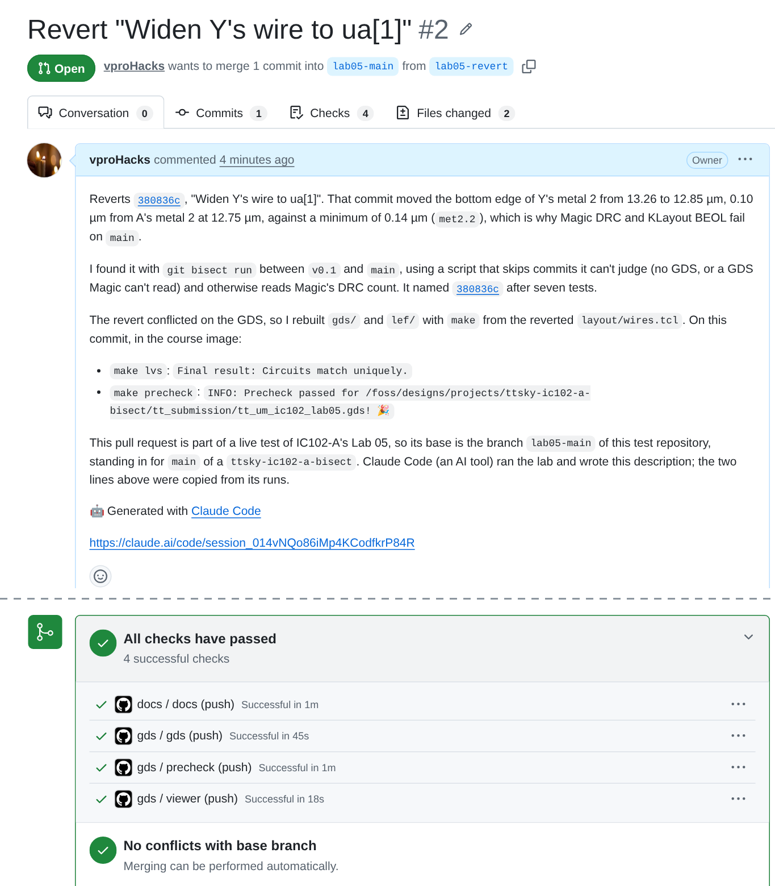

# Lab 05: Find the commit that broke it

You'll get the history of a small analog project, 33 commits long. Its `gds` workflow went red some
time after its last good release, and that release is now too long ago for anyone to remember what
broke it. You'll write a script that `git bisect run` can trust, use it to find the commit that
broke Magic DRC, and undo that commit through a pull request.

Package: [`labs/lab-05-find-the-commit-that-broke-it/`](https://github.com/uoftasic/ic102-a/tree/main/labs/lab-05-find-the-commit-that-broke-it)

## Before you start

- Read [History as evidence](../guide/history-as-evidence.md).
- Finish [Lab 03](lab-03-a-layout-that-passes-precheck-overview.md). This lab uses the course
  tools from Lab 01 and your token, but not your `ttsky-ic102-a`: the history gets a repository of
  its own in Part 5.

This lab takes about 55 minutes.

## Part 1: The history

What does the history tell you before you test anything?

1. Clone the history from the bundle file that the course ships, into a folder named after the
   repository you'll put it in on GitHub in Part 5, and set your identity in it:

   ```bash
   mkdir -p /foss/designs/projects && cd /foss/designs/projects
   git clone /foss/designs/modules/ic102-a/labs/lab-05-find-the-commit-that-broke-it/history.bundle ttsky-ic102-a-bisect
   cd ttsky-ic102-a-bisect
   git config user.name "Your Name"
   git config user.email "ID+USERNAME@users.noreply.github.com"
   git config credential.helper 'cache --timeout=28800'
   ```

   A bundle is a whole repository in one file. The commits in it have fixed authors and dates, so
   your hashes are the same as the ones below.

2. Look around:

   ```bash
   git log --oneline -3
   git tag -n
   git log --oneline -1 v0.1
   git log --oneline v0.1..main | wc -l
   ```

   You should see `main` at `fe045fa README: note that the gds workflow is red`; one tag, `v0.1`,
   described as `First layout that passes precheck and LVS`, on `4227d07 Place the inverter and
   wire it to ua[0] and ua[1]`; and 26 commits after it.

3. Confirm that `main` is broken the way the README says, with the runner's tools:

   ```bash
   make precheck
   ```

   You should see two ❌ rows, `Magic DRC | ❌ Fail: Magic DRC failed` and
   `KLayout BEOL | ❌ Fail: Klayout beol failed with 1 DRC violations`.

4. `git bisect` halves the suspects with every test. With 26 commits after the good one, how many
   tests should it need? Write the number down.

   <details>
   <summary>Answer</summary>

   Five: $2^5 = 32 \ge 26$, and four halvings would leave two suspects. git prints its own guess
   as it starts, "roughly 4 steps" after the first test.

   </details>

Check: you know the good commit (`v0.1`), the bad one (`main`), and how many suspects lie
between.

## Part 2: A first try

Can you hand git Magic's exit status and be done?

1. The package has a script that runs precheck's first check, Magic DRC, on one GDS file, with
   precheck's own Magic and PDK:
   `magic-drc.sh GDS TOP_CELL REPORT_DIR`. Run it on `main`:

   ```bash
   LAB=/foss/designs/modules/ic102-a/labs/lab-05-find-the-commit-that-broke-it
   $LAB/magic-drc.sh gds/tt_um_ic102_lab05.gds tt_um_ic102_lab05 /tmp/lab05-drc; echo "exit=$?"
   head -6 /tmp/lab05-drc/magic_drc.txt
   ```

   You should see `exit=255`, and a report that starts with the rule that's broken:

   ```
   tt_um_ic102_lab05
   ----------------------------------------
   Metal2 spacing < 0.14um (met2.2)
   ----------------------------------------
    141.200 12.710 142.740 12.750
    142.600 12.710 142.740 12.750
   ```

   and, two lines from its end, `[INFO]: COUNT: 4`.

2. Read `$LAB/first-try.sh`. It runs that script at whatever commit git has checked out and exits
   with its status. Before you run it, read the rule from the git manual that
   [History as evidence](../guide/history-as-evidence.md#finding-the-commit-that-broke-it)
   quotes, and write down what git will do with an exit status of 255.

3. Run it:

   ```bash
   git bisect start main v0.1
   git bisect run $LAB/first-try.sh
   git bisect reset
   ```

   You should see the first test pass and the second stop the whole bisect:

   ```
   Bisecting: 12 revisions left to test after this (roughly 4 steps)
   [b08fd6d6b800b1136b1b8972582ebc554781965d] Keep build output out of git
   running '/foss/designs/modules/ic102-a/labs/lab-05-find-the-commit-that-broke-it/first-try.sh'
   Bisecting: 6 revisions left to test after this (roughly 3 steps)
   [02d92af0591d429d331499929756e07d71531c48] README: rename the build section
   running '/foss/designs/modules/ic102-a/labs/lab-05-find-the-commit-that-broke-it/first-try.sh'
   error: bisect run failed: exit code 255 from '/foss/designs/modules/ic102-a/labs/lab-05-find-the-commit-that-broke-it/first-try.sh' is < 0 or >= 128
   ```

   <details>
   <summary>Answer</summary>

   git accepts 0 (good), 1 to 127 except 125 (bad) and 125 (skip). Anything else, and 255 in
   particular, it treats as the script itself having failed, and it stops. Magic's DRC script exits
   with `exit -1`, which the shell sees as 255, so the first commit with an error stops the bisect.
   Mapping 255 to 1 would fix that. It wouldn't fix what went wrong in the first test, though, and
   that's what Part 3 is about.

   </details>

Check: you've seen `bisect run failed: exit code 255`, and run `git bisect reset`.

## Part 3: A script git can trust

What can go wrong at a commit, besides the layout being bad?

1. The first test above was `b08fd6d Keep build output out of git`, and `first-try.sh` called it
   good. Check out that commit and look at what Magic did:

   ```bash
   git checkout b08fd6d
   ls gds/
   $LAB/magic-drc.sh gds/tt_um_ic102_lab05.gds tt_um_ic102_lab05 /tmp/lab05-drc; echo "exit=$?"
   grep -A2 "couldn't be read" /tmp/lab05-drc/magic.log
   ```

   You should see `ls: cannot access 'gds/': No such file or directory`, `exit=0`, and:

   ```
   Cell tt_um_ic102_lab05 couldn't be read
   No such file or directory
   Creating new cell
   ```

   There's no layout at this commit at all. Magic couldn't find the cell, made an empty one,
   checked it, and found nothing wrong. Its report says `COUNT: 0` too, so a script that reads
   only the count is fooled just as `first-try.sh` was.

2. List the commits after `v0.1` that changed the GDS, with the size of each version:

   ```bash
   git log --oneline --stat v0.1..main -- gds/
   ```

   Find the second commit that can't be tested: one where the GDS shrank to 6000 bytes and the
   next commit put it back. Check it out and run `magic-drc.sh` on it. You should see `exit=255`,
   `COUNT: 58`, and in `magic.log`, twice:

   ```
   Error while reading cell "tt_um_ic102_lab05" (byte position 6000): Unexpected EOF.
   ```

   That's `5e0f367 Add a second inverter (WIP)`, a GDS cut short when Magic crashed while writing
   it. Magic read what was there and reported 58 errors in the fragment, so a script would call
   this commit bad when in fact it can't be judged at all.

3. Go back with `git checkout main`, and write your own script, `/foss/designs/projects/bisect.sh`,
   outside the repository so that bisect's checkouts can't change it. It has to exit:

   - **125** when there's no `gds/<top_module>.gds`, or Magic's log shows it couldn't read the
     cell, or the report has no `COUNT` line;
   - **1** when the count is above 0;
   - **0** when the count is 0.

   Read `top_module` from `info.yaml` with
   `python3 -c 'import yaml; print(yaml.safe_load(open("info.yaml"))["project"]["top_module"])'`,
   run `magic-drc.sh` without using its exit status, and decide from `magic.log` and
   `magic_drc.txt`. Then `chmod +x` it.

4. Test it by hand on the four kinds of commit before you give it to git:

   ```bash
   for c in v0.1 b08fd6d 5e0f367 main; do git checkout -q $c; /foss/designs/projects/bisect.sh > /dev/null 2>&1; echo "$c $?"; done
   git checkout -q main
   ```

   You should see `v0.1 0`, `b08fd6d 125`, `5e0f367 125` and `main 1`. If not, fix the script
   before Part 4, because git decides from your script's exit status alone, and one wrong answer
   sends the bisect into the wrong part of the history.

Check: your script gives those four answers.

## Part 4: Bisect

1. Run it:

   ```bash
   git bisect start main v0.1
   git bisect run /foss/designs/projects/bisect.sh
   ```

   It takes a few seconds. You should see seven tests, the first one skipped, and then:

   ```
   380836cbb3704d4afa0915f9b43a4bb4d3bf0111 is the first bad commit
   commit 380836cbb3704d4afa0915f9b43a4bb4d3bf0111
   Author: Sam Example <sam@example.com>
   Date:   Sun Oct 11 22:40:00 2026 -0400

       Widen Y's wire to ua[1]

       The output wire carries more current than the input one, so give it twice the width.

    gds/tt_um_ic102_lab05.gds | Bin 19636 -> 19572 bytes
    layout/wires.tcl          |   2 +-
    2 files changed, 1 insertion(+), 1 deletion(-)
   bisect found first bad commit
   ```

   That's seven tests against the five you predicted, because git skipped `b08fd6d` and had to
   choose another commit near the middle, and the skipped test still counts as one of the seven.

2. Run `git bisect reset`, then read the commit: `git show 380836c -- layout/wires.tcl`. The
   change is one number: the bottom edge of `Y`'s metal 2 moved from 13.26 to 12.85 µm. `A`'s metal 2
   runs from 12.3 to 12.75 µm. How far apart are they now, and what's the minimum?

   <details>
   <summary>Answer</summary>

   12.85 − 12.75 = 0.10 µm, against a minimum of 0.14 µm for metal 2 (`met2.2` in Magic's
   report). The
   commit's message gives a good reason for a wider wire, and the wire is wider; it just grew
   towards its neighbour. git bisect never reads commit messages, only your script's exit status.

   </details>

3. A classmate's script reads only the `COUNT` line and exits 0 when it's 0. Which commit would git
   have named with it?

   <details>
   <summary>Answer</summary>

   `a4605db Put gds/ and lef/ back: the gds workflow reads them from the repository`. The script
   calls `b08fd6d` good even though it has no GDS, so git looks only at the commits after it, and
   the next commit with a GDS is the one that put it back. That commit's message would make a very convincing culprit. We
   ran that script on this history to check, and that's the commit it named.

   </details>

Check: your bisect named `380836c`.

## Part 5: Undo it through a pull request

1. Put the history on GitHub, so that its workflows run. Make a new repository (the **+** menu ›
   **New repository**) with your own account as the owner, the name `ttsky-ic102-a-bisect`,
   **Public**, and no README, `.gitignore` or licence. Then point your clone at it, instead of at
   the bundle, and push `main`:

   ```bash
   git remote set-url origin https://github.com/YOUR-USERNAME/ttsky-ic102-a-bisect.git
   git push -u origin main
   ```

   The history includes `.github/workflows/`, so this is one of the pushes that needs your token's
   Workflows permission.

2. Turn on Pages (Settings › Pages › Source: **GitHub Actions**), then start a new run: Actions ›
   `gds` › **Run workflow** on `main`, not "Re-run failed jobs". You should see `docs` green, and in
   the `gds` workflow, the `gds` and `viewer` jobs green and `precheck` red. That's the state the
   README describes.

   When we tested this on Nov 16, 2026 (with the history pushed to a branch of a test repository
   rather than to a repository of its own), the push's `docs` run passed, and its `gds` run had
   `gds` green, `viewer` red with `Failed to create deployment (status: 404)`, and `precheck` red
   with the two rows from Part 1:

   ```
   | Magic DRC | ❌ Fail: Magic DRC failed |
   | KLayout BEOL | ❌ Fail: Klayout beol failed with 1 DRC violations |
   ```

   The run started with Run workflow after Pages was on took 2 min 51 s, with `gds` and `viewer`
   green and `precheck` red with the same two rows.

3. Make a branch from `main` and revert the commit:

   ```bash
   git switch -c lab05-revert
   git revert --no-edit 380836c
   ```

   You should see:

   ```
   warning: Cannot merge binary files: gds/tt_um_ic102_lab05.gds (HEAD vs. parent of 380836c (Widen Y's wire to ua[1]))
   Auto-merging gds/tt_um_ic102_lab05.gds
   CONFLICT (content): Merge conflict in gds/tt_um_ic102_lab05.gds
   Auto-merging layout/wires.tcl
   error: could not revert 380836c... Widen Y's wire to ua[1]
   hint: After resolving the conflicts, mark them with
   hint: "git add/rm <pathspec>", then run
   hint: "git revert --continue".
   hint: You can instead skip this commit with "git revert --skip".
   hint: To abort and get back to the state before "git revert",
   hint: run "git revert --abort".
   ```

   <details>
   <summary>Why does the GDS conflict when the text file doesn't?</summary>

   Undoing a commit means applying its change backwards to today's files. For `wires.tcl` that's
   easy, because no later commit changed that line. Three later commits changed the GDS, and
   git can't apply a binary change to a different binary, so it stops and asks.

   </details>

4. Resolve it the way you did in Lab 04: rebuild the GDS and LEF from the reverted sources, then
   check and finish the revert:

   ```bash
   make
   git add gds lef
   git revert --continue --no-edit
   make lvs
   make precheck
   ```

   `--no-edit` keeps git's message, `Revert "Widen Y's wire to ua[1]"`, instead of opening an
   editor. You should see `Final result: Circuits match uniquely.` and `Precheck passed`.

5. Push the branch and open a pull request from `lab05-revert` into `main`:

   ```bash
   git push -u origin lab05-revert
   ```

   In the description, name the commit you're reverting, say how you found it, and paste the
   `make lvs` and `make precheck` lines. The template's workflows run on every push, so the branch
   gets its own `docs` and `gds` runs, and the pull request shows them.

   <!-- Screenshot: vproHacks/ic102-test-a#2 on Nov 16, 2026, whose base is the branch lab05-main that stood in for main of a ttsky-ic102-a-bisect. -->
   {width=640}

6. When the branch's `gds` run is green in all three jobs, merge the pull request with
   **Create a merge commit**. The merge is a push to `main`, so it gets a run of its own. In our
   test, the branch's `gds` run passed all three jobs in 2 min 44 s (`gds` 45 s, `precheck`
   1 min 54 s, `viewer` 18 s), and the run on the merge passed all three in 3 min 8 s.

Check: the `gds` run on `main` after the merge is green in all three jobs.

## Finishing

You're done when your bisect has named `380836c`, and `main` of your `ttsky-ic102-a-bisect`, with
the revert merged, has a green `docs` run and a green `gds` run with all three jobs.

Questions:

1. Your script had to treat a missing GDS as "can't test". In the history, is there anything else
   that would make a commit untestable for this check, even with a GDS that Magic reads?

   <details>
   <summary>Answer</summary>

   A `top_module` in `info.yaml` that doesn't match the cell inside the GDS, as in Lab 02's
   breakage 3: Magic would look for the wrong cell, find none, and check an empty one. Your script
   catches that through the "couldn't be read" line, and that's one reason to judge from Magic's
   log rather than from guesses about which files exist.

   </details>

2. The good commit was easy to find because someone tagged it. What would you have used without
   the tag?

   <details>
   <summary>Answer</summary>

   A commit with a green `gds` run on GitHub, if its runs were still there (they're kept 90 days by
   default), or the oldest commit with a GDS, tested by hand with the same script. Tagging the
   commit you'd stand behind, as [History as evidence](../guide/history-as-evidence.md#marking-a-commit)
   suggests, saves this search.

   </details>

Submit: nothing for this lab.

This is the last row of the [Course path](../index.md#course-path).
